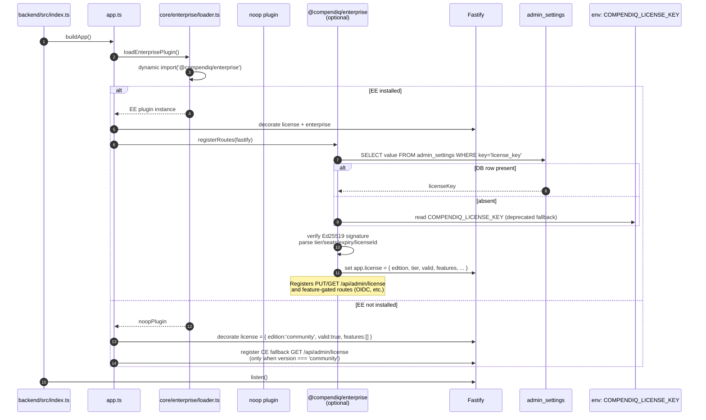
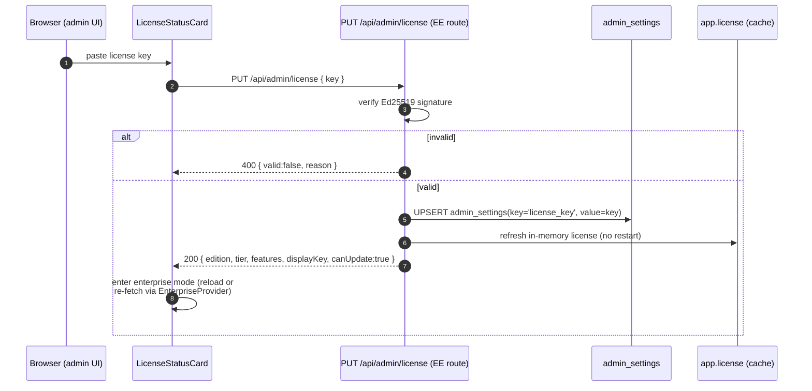
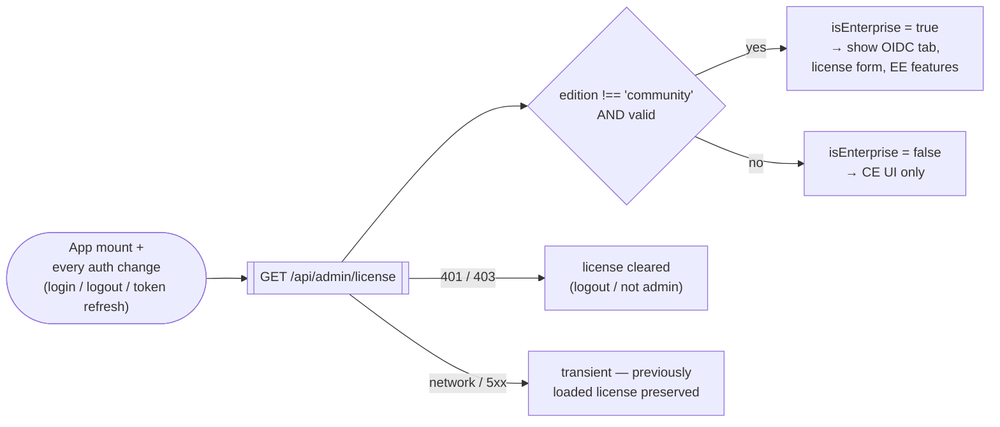
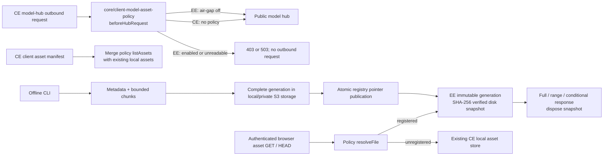
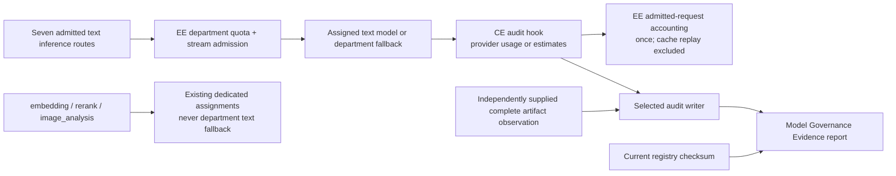
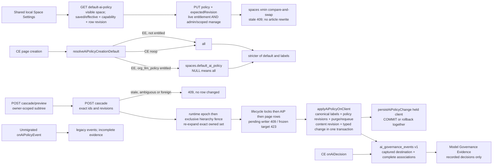

# 10. Enterprise License Flow (Open-Core)

Compendiq ships as an open-core product. CE (this repo) defines the plugin
contract, a noop stub, and the UI surfaces for license management. EE is
published privately as `@compendiq/enterprise` and implements the real
plugin. See `docs/ENTERPRISE-ARCHITECTURE.md` for the full design.

## Boot-time plugin load



**The package's DEFAULT export is the plugin — nothing else is consulted.**
`loader.ts` reads `mod.default` and accepts it only when it carries a
`validateLicense` function; a package that exposes the plugin through named
exports alone, or whose default export is some other object, is logged
(`Enterprise package found but its default export is not a plugin`) and the
noop plugin is used. There is no namespace-object fallback and no
compatibility shim: the cutover to the default export is clean, so an EE
build that forgets `export default plugin` fails visibly at boot (every EE
feature, including `resolveAiPolicyCreationDefault` for #280, stays inert)
rather than half-loading.

## Runtime license update (EE only)



## GET /api/admin/license response shape

| Mode | Response |
|------|----------|
| **CE (noop)** | `{ edition:'community', tier:'community', valid:true, features:[] }` |
| **EE valid**  | `{ edition:'enterprise', tier:'business'\|'enterprise', valid:true, features:[...], displayKey, licenseId, canUpdate:true }` |
| **EE invalid / expired** | `{ edition:'enterprise', valid:false, reason:'expired', canUpdate:true }` |

The frontend uses `canUpdate` to decide whether to render the key-entry
form; CE omits the flag.

## License key format

```
ATM-{tier}-{seats}-{expiryYYYYMMDD}-{licenseId}.{ed25519SignatureBase64url}
```

- **v2** includes `{licenseId}`; **v1** is accepted for backwards compat.
- Signed with an Ed25519 key pair — the public key is compiled into the
  EE plugin; the private key is held by the vendor.
- Persisted in the `admin_settings` table under key `license_key`.
- The `COMPENDIQ_LICENSE_KEY` env var is a **deprecated bootstrap
  fallback** — consulted only when the DB row is absent.

## Frontend gating recap



The fetch runs on mount **and whenever the access token changes** (a
post-mount SPA login must flip EE surfaces on without a reload; logout
clears the previous session's license/ui from memory). Only a genuine
auth signal (401/403) clears the license — transient failures (network
error, 5xx) leave the previously loaded license untouched, and the
loading skeleton shows on the initial load only.

CE and EE ship the **same frontend image**. There is no IIFE bundle, no
build-time patch, no separate EE SPA. All gating happens at runtime via
`useEnterprise()`.

### The one edition consumer that does not use `/api/admin/license`

The **login page** is unauthenticated, so it cannot call that admin route at
all. Its edition badge comes from the public
`GET /api/auth/login-page-config`, which reports `'enterprise'` whenever the
loaded plugin is not the noop shim — deliberately derived from the *build*,
not the license, since an EE deployment whose license lapsed is still not
"Community Edition · AGPL-3.0", and claiming otherwise on the sign-in screen
would be a licensing statement we have no grounds for.

`edition` is **optional** in `LoginPageConfigResponseSchema`. An EE stack pins
the CE frontend by image tag (`compendiq-ce-frontend:${CE_TAG:-dev}`) while its
backend is built from an older CE release, so the SPA regularly talks to a
backend predating the field; absent means "unknown" and the badge is omitted
rather than guessed. A required key would throw in `.parse()` and take the
unrelated `variant` down with it.

## Key files (CE side)

| File | Purpose |
|------|---------|
| `backend/src/core/enterprise/types.ts` | `EnterprisePlugin`, `LicenseInfo`, Fastify augmentation |
| `backend/src/core/enterprise/features.ts` | `ENTERPRISE_FEATURES` constants |
| `backend/src/core/enterprise/noop.ts` | Inert CE stub |
| `backend/src/core/enterprise/loader.ts` | Dynamic import + fallback |
| `backend/src/core/types/compendiq-enterprise.d.ts` | Type declaration for the optional EE package |
| `backend/src/app.ts` | CE fallback `GET /api/admin/license` (community-mode inline route) |
| `frontend/src/shared/enterprise/context.tsx` | `EnterpriseProvider` |
| `frontend/src/shared/enterprise/use-enterprise.ts` | `useEnterprise()` hook |
| `frontend/src/features/admin/LicenseStatusCard.tsx` | Admin UI for the license |
| `frontend/src/features/admin/OidcSettingsPage.tsx` | EE-gated OIDC config UI |
| `frontend/src/features/auth/OidcCallbackPage.tsx` | EE-gated OIDC callback handler |
| `docker/Dockerfile.enterprise` | Multi-stage Dockerfile template for EE builds |

## Model registry and inference evidence extension points



The policy lives in `core/services/client-model-asset-policy.ts`; Community
has no implementation and retains its existing behavior. EE registration
returns an app-lifetime disposer. Every outbound hub fetch checks policy,
including inspection reached through automatic HEAD and each install fetch.
An existing registry entry whose verification fails never falls back to an
unchecked CE copy. Full, ranged, HEAD and conditional responses all verify the
source before serving or returning metadata. Registry snapshots use the data
volume, not the deployment's bounded `/tmp` tmpfs.



Summarize, Diagram and Quality use the shared SSE audit lifecycle; inline
completion reports counts without prompt/completion plaintext. Department
accounting is composed once with the selected writer, not repeated inside it.
Only an independently supplied artifact pair can populate checksum/asset
evidence: matching a model name is not an observation. Registry checksum
agreement is not proof of execution or network isolation. No browser audit
producer is introduced by these hooks.

The shared `ReportId` contract and `ComplianceReportsTab` include
`model_governance`; the live backend's `available` list controls generation.
There is no EE frontend overlay. The EE report states retained audit coverage
and ships CSV plus an unsigned checksum PDF cover in a ZIP.

## Article AI policy enterprise extension points (SPEC-EE-001)



`applyAiPolicyOnClient` owns the awaited `persistAiPolicyChange(client, event)`
call after policy/label and derived-state changes. The cascade supplies one
server-owned operation/cascade identity, user actor and `subtree_cascade`
source; it does not insert a second aggregate. The primitive reads old policy
and revisions from locked rows. Sink failures propagate to the transaction
owner and roll back policy and evidence together. The cascade still owns
content-revision publication and its hierarchy/lifecycle fences. Direct policy
updates no longer emit a second post-commit notification. Interactive direct
relaxation stores `all-ai`.

The legacy `emitAiPolicyChanges` export has been removed. Creation/recovery
callers that change policy use held-client typed persistence rather than a
post-commit observer. This does not establish complete producer coverage or
rollout readiness: retained legacy records and decision-delivery gaps remain
explicitly bounded by the report. Restrictive activation remains closed.

### Relocation recovery verification before publication

A retained relocation preparation is durable local progress, not evidence of a
remote dispatch. In the committed-preparation recovery regression, the lifecycle
lock can stop either preparation finish or the next local effect's start:
`effect_finished_at` may therefore be null or populated. Do not interpret that
field alone as settlement or permission to retry a remote operation. Recovery
still requires the established runtime fencing and active recovery authority,
a pending/unsettled intent, and durable evidence that no remote effect started.
The regression verifies retained preparation/FK protection, no provider calls,
cleanup after actor deletion or deactivation, and preservation of the original
body, revisions, children and ACLs. Its synchronization must not depend on
sleeps, retries, or one incidental local-effect timestamp value.

Run the full backend gate after changing this regression, along with the other
required integration, contract, frontend, lint and typecheck gates. Earlier
unchanged-tree reruns or focused parent runs are not evidence of a repair.
These native gates do not replace browser verification of defaults, cascades,
report downloads or entitlement-loss recovery. Keep publication draft-only and
remote completion withheld until the outstanding publication checks are met;
this test correction changes neither production recovery nor activation rules.

The EE hook is wired into the plugin only; CE routes and ingestion keep
calling `resolveCreationAiPolicy`. Losing the license makes the hook answer
`all` for new pages but never rewrites stored page restrictions. Event
recording is an observer of a decision already taken: an audit failure is
logged and never turns a denied dispatch into an admitted one. There is no
live inheritance resolver; a cascade writes each owned row once.

The same `canMutateAiPolicy` hook that guards every later policy move also
guards the **choice at creation** (`canChoosePolicyAtCreation`, #280): CE
answers from ownership/edit rights, EE from its governance rules, and a
creator the hook refuses cannot set a policy through `POST /pages` either
(403 `ai_policy_denied` before any row or remote effect). Typed producers can
record complete blocked-stage evidence, including unknown policies. Legacy
producer coverage remains incomplete; observer delivery failure leaves a gap,
never permission to dispatch. See [audit flow](./13-flow-ai-policy-audit.md) and
[typed data model](./14-ai-governance-evidence-schema.md). Provider locality declarations are actor-bound: `POST/PATCH
/api/llm/providers` with a `locality` and no identified administrator is 401
`locality_actor_required`, and a `local` declaration without a declarer is
not local for admission purposes.
