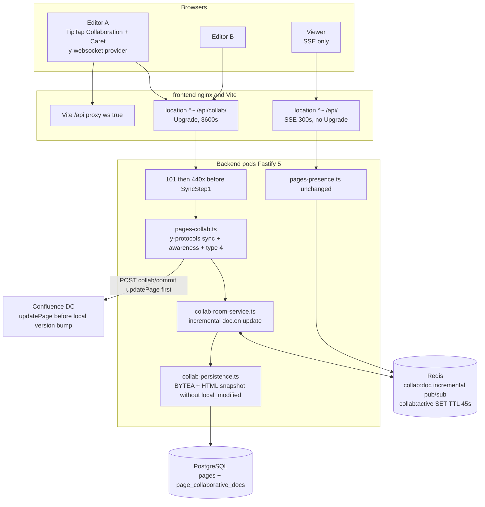
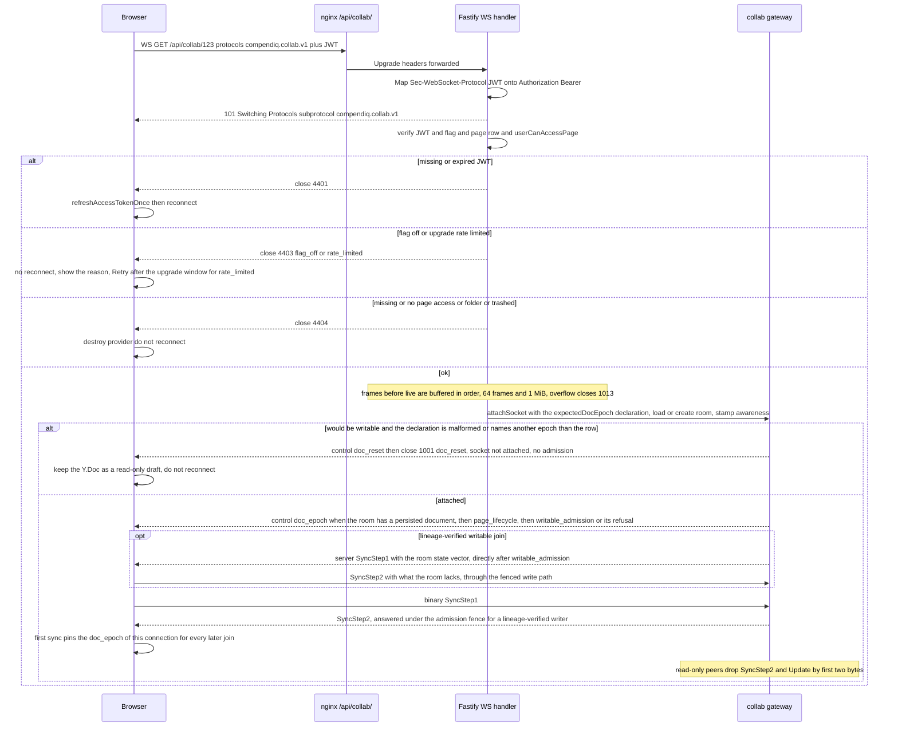
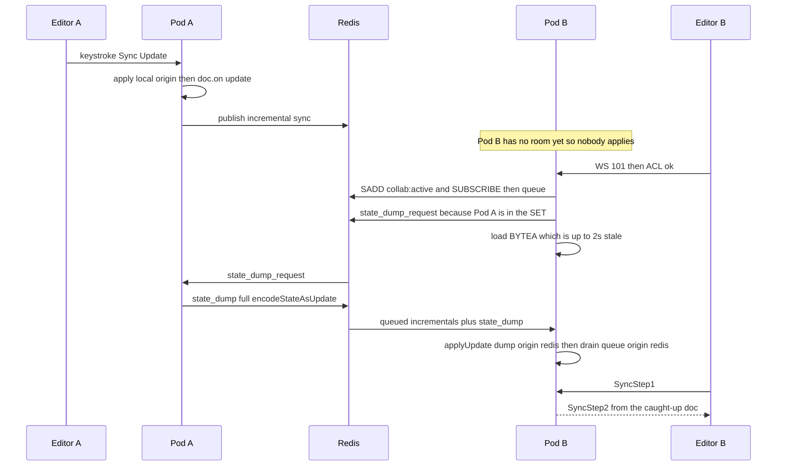

# 12. Real-time Collaborative Editing

Opt-in Yjs CRDT sessions so two (or more) writers on the same article
converge without a `PUT /api/pages/:id` 409. Gated by
`admin_settings.collab_editing_enabled` (seeded `'0'` — **default off**).
Flag off ≡ today's TipTap draft + #301 SSE presence.

Design of record: [`docs/superpowers/specs/2026-08-24-realtime-collaborative-editing-design.md`](../superpowers/specs/2026-08-24-realtime-collaborative-editing-design.md)
(epic [#1411](https://github.com/Compendiq/compendiq-ce/issues/1411), architecture PR [#1443](https://github.com/Compendiq/compendiq-ce/issues/1443)).
This diagram is the topology later PRs implement. The table exists from
migration 104 and the bundled `/api/collab/` nginx location plus Vite
`ws: true` ship here; the editor wiring does **not**.

## Topology

Clients talk to a Fastify 5 WebSocket gateway. Incremental Yjs updates
fan out across pods on Redis pub/sub. Postgres holds the BYTEA persist
form and the 2 s HTML snapshot. Confluence storage is written **only** on
explicit commit.

The bundled `location ^~ /api/collab/` and Vite `/api` `ws: true` ship
in `frontend/nginx.conf` and `frontend/vite.config.ts`. Corporate
reverse-proxy snippets live in `docs/integrations/reverse-proxy/`.

## Gateway (not Hocuspocus)

Embed the Yjs sync/awareness protocol in Fastify 5:

- `@fastify/websocket` (Fastify 5 peer) + `y-protocols` + `yjs` (same
  major as TipTap 3) + `lib0`
- Frontend: `y-websocket@^3.1.0` (2.x always reconnects; 3.1 treats
  4400–4499 as permanent and emits `closed`), `@tiptap/extension-collaboration`,
  `@tiptap/extension-collaboration-caret`, `@tiptap/y-tiptap`

**Rejected:** Hocuspocus (custom multiplexed protocol, second listen/crossws
stack), a standalone `y-websocket` sidecar (JWT and `userCanAccessPage`
would have to be reimplemented), Liveblocks, TipTap Cloud.

v1 registers **one** WebSocket route. `handleProtocols` is a plugin-global
`WebSocket.Server` option: select only `compendiq.collab.v1`, never echo
the JWT as the chosen subprotocol.

## Handshake — 101 first, then 440x before SyncStep1

A browser `WebSocket()` cannot set `Authorization` and **cannot see HTTP
401/403/404** on a failed upgrade (it only gets close 1006). `y-websocket`
treats 1006 as transient and would reconnect forever with a dead JWT.
`use-presence.ts` is `fetch()` of SSE — it is **not** the precedent.

JWT arrives as `Sec-WebSocket-Protocol: compendiq.collab.v1, <jwt>`.
**Never** the query string (nginx logs `$request_uri`). A real
`Authorization: Bearer` header is also accepted (Node tests).

| Code | Reason | When | Client before the first sync | Client after the first sync |
|------|--------|------|------------------------------|-----------------------------|
| **4401** | `unauthorized` | Missing / invalid / expired JWT, deactivated user or changed role (y-websocket 3.1 permanent — client handles `closed`, refreshes JWT, `connect()`s) | Refresh and rejoin. No session left: "Your session expired" | Refresh and rejoin. No session left: read-only draft |
| **4403** | `forbidden` | Page access revoked mid-session (60 s permission refresh) | "You cannot join this collaborative session." Fail closed, no Retry | Read-only draft (`permission_loss`) |
| **4403** | `rate_limited` | More than 20 upgrades by the user in the fixed `COLLAB_UPGRADE_WINDOW_SEC` (60 s) window | "Too many connection attempts". Retry becomes available one full window after the refusal | Read-only draft (`rate_limited`): "Too many connection attempts from your account." No rejoin |
| **4403** | `flag_off` | Flag off at join, or mid-session (every pod tombstones its rooms) | "Collaborative editing has been turned off". The client refetches `GET /api/collab/config`, no Retry | Read-only draft (`flag_off`): "Collaborative editing was turned off." The client also refetches `GET /api/collab/config` |
| **4403** | `readonly` | 8 refused write frames from a read-only socket after the join (`COLLAB_READONLY_DROP_LIMIT`). Never sent for pre-live buffering | "The collaborative session closed before it finished loading." with Retry | Read-only draft (`readonly`): "The server stopped accepting changes from this tab." |
| **4403** | any other | — | Treated as `forbidden` (fail closed) | Treated as `forbidden`: read-only draft (`permission_loss`), also for an empty reason |
| **4404** | `not_found`, `trashed`, `folder`, `committed_delete` | Missing page, no page access at join (answered exactly like a missing page, checked before lifecycle state), `page_type = 'folder'`, or committed trash (`deleted_at`) | "This page is no longer available for collaborative editing." | Read-only draft (`not_found`) |
| **1013** | `join_backlog` | The pre-live buffer overflowed (below) — reconnect | "Could not connect to the collaborative session. Retrying…" while y-websocket reconnects | Working offline, then reconnect |
| **1001** | `doc_reset` | The document lineage changed (#2034): a join that would be writable declared a malformed `expectedDocEpoch` or another epoch than the page's row (refused before any admission, socket never attached); a room was retired because its `page_collaborative_docs` row was deleted or replaced; a read-only room adopted the document a writable join seeded; an older pod reset the document in place. Always preceded by the `doc_reset` control | "This page was replaced while the editor was opening" | Read-only draft (`document_changed`) with **Download draft**, no reconnect |
| **1001** | `commit_unknown` | The page's own collaborative Save failed after dispatch and its result is unknown (#2035). Sent to every socket that was writable, after the `commit_unknown` control and the `permission_loss` compatibility cue. Not a new close code | "A collaborative save of this page did not finish, and its result is unknown. Editing is paused until that save is resolved." | Read-only draft (`commit_unknown`) with **Download draft** and **Open current version**, no reconnect |
| **1001** | any other | Transient: shutdown, an in-flight Confluence hide, a refused frame fence (`collab_validation_unavailable`), a lost transport — reconnect | "Could not connect to the collaborative session. Retrying…" | Working offline, then reconnect |
| HTTP 401 (no socket) | — | Optional Node-only `inject()` of a non-upgrade GET. Not the browser path. | — | — |

**Before live (#1895).** Until the join completes (JWT, flag, page row,
access, upgrade limit, edit permission, `attachSocket`), the gateway buffers
inbound frames in arrival order, at most 64 frames and 1 MiB. When the socket
goes live they are handled before any later frame, under the same read-only
rules, so a read-only socket that queued writes still reaches the drop limit.
An overflow closes `1013 join_backlog`, which y-websocket retries. Buffering
never produces a 4403. Before the first sync the editor shows exactly one of
the messages above, never the read-only draft banner or **Download draft**;
Save stays blocked, and title, tags and icon unlock with the first sync.

**Gateway handoff (#1928).** The server SyncStep1 of a lineage-verified
writable join is written inside the join's fenced final step, so the tab's
SyncStep2 reply can arrive before `attachSocket` returns and can be larger than
the pre-live buffer (an offline edit). The route therefore passes
`attachSocket` a `goLive` callback, which that final step calls synchronously,
inside its transaction and before it writes `writable_admission` and the
SyncStep1. `goLive` marks the socket live and moves the pre-live buffer, once
and in arrival order, onto the ordered frame chain behind a gate that opens
when `attachSocket` has returned; later frames, the reply included, append
behind them. `attachSocket` never awaits that chain, and no frame is handled
under the join transaction's lifecycle lock (each frame handler takes its own).
A rollback of the final transaction, or a close while the chain is gated,
drops the buffered frames instead of handling them. A join that does not reach
the final writable step goes live as before, after `attachSocket` returns. The
10 MiB WebSocket `maxPayload` (`backend/src/app.ts`) is the only bound on the
reply.

Close **after** the 101, **before** any SyncStep1. Do not throw
`fastify.authenticate` in `onRequest` on this route.

`:pageId` on the wire is integer `pages.id`, never `confluence_id`.

## Document epoch and join outcome precedence (#2034)

`page_collaborative_docs.doc_epoch` (migration 159, `UUID NOT NULL DEFAULT
gen_random_uuid()`) identifies one document lineage. A lineage starts when the
HTML seed of a writable join inserts the row and ends when that row is deleted;
nothing rewrites a row into another lineage, and a row inserted by a pod that
predates the column still gets its own value. The column is the only
authority: nothing in the `Y.Doc` carries the epoch and no client can change
it (amendment A2 to #2034, which first placed it in the `compendiq.meta` map:
that map is part of the document every writer and every merge can alter).

A room reads its `docEpoch` with the document: from the row on a read-only
load, from `INSERT … RETURNING` on the seed, from the row when a provisional
room adopts the persisted document. It is `null` exactly while the room has no
persisted document (an HTML-only reader room).

The client learns the epoch from a type-4 control and declares it on rejoin:

- **Control.** When a socket is attached to a room with a persisted document,
  the gateway sends `{ type: 'doc_epoch', epoch }` before the lifecycle and
  admission controls. A provisional room sends none.
- **Pin.** `use-collab-provider.ts` remembers the control of the current
  connection and pins it at the first sync of its `Y.Doc` (the document was
  empty before, so it is that lineage). A connection that closes before the
  first sync is forgotten. The pin never changes afterwards; later controls are
  ignored. A document whose first sync came without the control (older pod,
  provisional room) stays unpinned for its lifetime.
- **Declaration.** The pin is written to the provider's `params`, which
  y-websocket 3.1 turns into the URL on every connect, so each later join
  carries `expectedDocEpoch=<uuid>`. A first join declares nothing. The
  gateway reads the parameter as `absent`, `declared` (exactly one UUID) or
  `malformed` (an empty value, a repeated parameter, any other text).

The epoch is not a credential. Authentication, page access, edit permission
and the lifecycle checks run first and are unchanged; a declaration can only
end that join or leave the socket unverified.

**Join outcome precedence** (first match wins):

1. The route closes as before: 4404, 4401, 4403 `flag_off`, 4403
   `rate_limited`, `1001 no_runtime`.
2. The join would not be writable (no edit permission, a frozen page, a
   missing or stale `expectedLifecycleRevision`): today's outcome, attached
   read-only, **no epoch decision and no unknown-commit decision**.
3. `expectedDocEpoch` is malformed, or declared and different from the page's
   `doc_epoch` (or the page has no row): `doc_reset` control, close `1001
   doc_reset`, the socket is not attached and no admission is kept. Only the
   joining socket is affected: the room's other sockets stay, and a refused
   join does not cancel an empty room's eviction.
4. The page's own collaborative commit is unknown (#2035, below): the socket
   is attached read-only and sent `commit_unknown`, then `permission_loss`. It
   never receives `writable_admission` and takes no admission.
5. Otherwise the join is writable: `writable_admission`, then one server
   SyncStep1 when the join is lineage-verified (#1928, below).

A frozen page is step 2 whatever the join declares: the refused admission
gives it today's read-only outcome and the declaration is not looked at.

Step 3 is decided at four points, and a declared join is writable only when
its declaration equals the epoch of the document the room ends up holding.
The last of them also decides step 4:

- *Pre-check, before the admission.* A malformed declaration is refused with
  no read. Otherwise the row is read without locks. A room whose `docEpoch`
  differs from the row is a stale heap and is decided first: without an
  admission the unlocked read is proof (a row that changed never changes
  back); with an admission the row is read again under the page lifecycle
  lock. A stale heap is retired (`doc_reset` to its sockets) and the join
  restarts once against a fresh room, so a tab of the current generation that
  meets a superseded room is admitted, and a tab of an old generation still
  causes the stale room it found to be retired before it is refused. Then a
  declaration that differs from the row refuses the socket.
- *Admission precondition.* The same conditions run as the `precondition` of
  `admitPageRuntime`, inside the admission transaction under the page lifecycle
  lock that every invalidation, seed and inbound publication also takes, so a
  lineage that changes after the pre-check leaves no admission behind.
- *After the room has its document.* A provisional room loads, seeds or adopts
  its document in a transaction after the admission's, and the row can be
  deleted or reseeded in between. Before the room keeps the admission, the
  declaration must equal the epoch the room now holds; otherwise the admission
  this join acquired is released and the socket is refused. A room that already
  owns an admission accepts only a declaration equal to its own `docEpoch`.
- *The final step (#2035).* After every awaited preparation (admission, fresh
  room state, Redis bookkeeping) the socket is registered without write
  authority, and one admission-fenced transaction decides: it asserts on its
  own lifecycle-locked client that the row still carries the room's epoch,
  compares a declaration with the epoch the room ended up with, and asserts
  that the page's own commit is not unknown. Still inside that transaction,
  and without awaiting anything else, it makes the last socket, room and
  transport checks, calls the gateway's `goLive` (#1928), marks the socket
  writable and writes `writable_admission`, followed by the server SyncStep1
  of a lineage-verified join. A lineage that ended meanwhile retires the room
  (a declared join is answered `doc_reset`, an undeclared one is closed `1001`
  and reconnects into a fresh room); a declaration that no longer matches is
  refused with `doc_reset`, never admitted unverified. If the transaction
  fails the socket is closed and cleaned up. The positive control and the
  SyncStep1 are never written outside this fence.

`CollabSocket.lineageVerified` is true only for a writable socket whose join
declared the room's epoch. A join that declares nothing is admitted as before
and is never verified, a first join included (amendment A1: a first join has an
empty document and nothing to replay).

**Server SyncStep1 (#1928).** y-websocket sends a local edit only while its
socket is open and never queues it, so a frame refused with `1001
collab_validation_unavailable` or lost to a close, and an edit made while the
tab was disconnected after its first sync, would stay only in the tab: a later
collaborative Save then answers `409 collab_snapshot_not_received`. A
writable, lineage-verified join is therefore sent exactly one SyncStep1
carrying `room.doc`'s state vector, directly after `writable_admission` in the
fenced final step, and never again on that socket. The tab answers with a
SyncStep2 holding what the room lacks; it takes the ordinary fenced
`syncMutation` path (current-epoch assertion, unknown-commit fence, admission
and writable checks), so it grants nothing a writable socket could not already
send unprompted. No SyncStep1 goes to a read-only, `writable_refused`,
`commit_unknown` or demoted socket (a read-only socket's SyncStep2 would count
toward `COLLAB_READONLY_DROP_LIMIT`), nor to an undeclared join, whose
document could belong to another lineage (#2034). A tab that is refused a
write for its lifecycle or permission disconnects and never reconnects, so a
fenced draft is not replayed.

**Fenced answer to a verified writer (#1928).** A client SyncStep1 that
arrives on a socket the server holds as writable and lineage-verified (server
state, never a client claim) is answered inside an admission-fenced
transaction with `ownCollabCommit: 'proceed'`, like the replay, so a healthy
Save in flight does not refuse it. That transaction asserts the room's current
epoch, that the socket is still attached and writable under the room's
admission, and that the page's own commit is not `unknown`; only then is the
SyncStep2 encoded and queued. A failed assertion sends no answer and follows
that fence's outcome: a lineage change retires the room (`doc_reset`), an
unknown commit demotes the socket (`commit_unknown`), any other refusal closes
it `1001 collab_validation_unavailable`. A SyncStep1 from any other socket is
answered as before, without a transaction.

Type-4 control frames (JSON, server to client):

| Control | Meaning |
|---------|---------|
| `doc_epoch` | Epoch of the room's persisted document; sent once per join, first (#2034) |
| `page_lifecycle` | Lifecycle revision, frozen state and baseline of the page |
| `writable_admission` | Positive write admission at exactly that lifecycle revision. Written only inside the fenced final step of the join |
| `writable_refused` | The join stays read-only: lifecycle revision missing or stale |
| `permission_loss` | No edit permission at join, or revoked later. Also sent directly after `commit_unknown`, so a client that predates that control keeps its draft and does not reconnect |
| `commit_unknown` | The page's own collaborative Save failed after dispatch and its result is unknown; no further edit is accepted until it is resolved (#2035). No payload |
| `pages_version` | A collaborative Save settled at that `pages.version` |
| `doc_reset` | The document lineage changed; the client keeps its `Y.Doc` as a draft |
| `tombstone` | The page was hidden or deleted |

## Dual-run with #301 SSE

`GET /api/pages/:id/presence` is **not** retired.

- Flag on, user in the collab room: Yjs awareness feeds
  `PresenceAvatarStack` for editors. SSE continues for viewers who have
  the page open but are not editing. Merge by `userId`. Pencil badge =
  collab-room membership, not the SSE heartbeat's `isEditing`.
- Flag off: today's SSE `isEditing` heartbeat is unchanged.

The server stamps awareness `{ id, name, color }` after JWT and **ignores**
client-claimed identity. Color is deterministic from `userId`.

## Live Y.Doc vs snapshot vs commit

| Representation | When it moves | Versioning / side effects |
|----------------|---------------|---------------------------|
| In-memory `Y.Doc` + Redis **incremental** `doc.on('update')` | Every keystroke | Live truth. `Y.applyUpdate(..., 'redis')` on receive so the handler does not loop. |
| `page_collaborative_docs.doc_state` / `state_vector` | Debounced **2 s** after last applied update, and immediately when the last editor disconnects | Increments **this table's** `version` (persistence generation). Always. |
| `pages.body_html` + `pages.body_text` | Same 2 s debounce (and last-disconnect) | **Does not** increment `pages.version`. **Does** raise `embedding_dirty`, and `image_analysis_dirty` when `body_html` actually changed (#1618 stage 2 retired the `image_embedding_dirty` write that used to sit beside it). **Does not** stamp `local_modified_*`. **Does not** re-queue summary/quality. **Does** advance `pages.content_revision` (migration 120 trigger), so a Confluence commit pins lifecycle and version, not that revision, across its provider read (#1762). |
| `pages.body_storage` (XHTML via `htmlToConfluence`) | Explicit Save/Publish / `POST /api/pages/:id/collab/commit` only | Commit increments `pages.version` (standalone locally; Confluence takes `GREATEST(version + 1, acknowledged)` **after** `updatePage` succeeds and records the acknowledgment in `remote_version`). It also resets `pages.body_html` / `body_text` to the committed snapshot: edits typed after that snapshot stay in the room; a persist that falls inside the Save's intent waits for it (#1763), so they reach `page_collaborative_docs` and `body_html` on the flush that the Save's `pages_version` control starts, the next edit's 2 s debounce, or the last-writer flush (#1762). |
| Confluence DC | Collab commit for `source = 'confluence'` | Remote write **first**, same order as today's PUT |

Stamping `local_modified_*` on the 2 s path is forbidden:
`applyConflictPolicyForExistingPage` treats `local_modified_at > last_synced`
as `hasLocalEdits`, default policy is confluence-wins, and snapshot HTML is
not byte-identical to the last Confluence conversion. That combination
would overwrite live CRDT work on the next sync tick.

BYTEA persist is always the full `Y.encodeStateAsUpdate`. Redis pub/sub is
**never** that — it publishes the incremental `update` argument. Mixing
those two floods every keystroke as a full document.

**Images a Confluence commit uploaded (#1764).** The commit publishes
`body_html` with `data-confluence-filename` and
`data-confluence-image-source="attachment"` on the pasted images it uploaded;
those markers make the next commit's image plan skip them. After the intent
settles, and before its `pages_version` control, the commit marks the same
images in the room so the next persist keeps them. The pod that owns the room
applies an in-place Yjs transaction under its room admission (the fence a
client frame uses) with its own origin, `COLLAB_IMAGE_MARKER_ORIGIN`:
`doc.on('update')` persists it, publishes it once as an incremental `sync` and
sends it to every socket; peers apply it with origin `'redis'` and do not
republish it. A commit pod whose own room did not take the mark (no room for
the page, a room without a writable admission, a room at another lifecycle
revision, or a room released while the step waited for the page lock)
publishes `image_markers` with the Save's lifecycle revision, and each pod
whose room owns the page at that revision applies the same transaction. A pod
without such a room ignores the message, and every pod ignores a malformed
one. The commit also marks `page_collaborative_docs` under its own request
admission, so a room that loads later, a persist (which merges the persisted
document first) and the next commit snapshot keep the markers even when no
room owned the page or the owning pod missed the message. Only `image` nodes
whose current `src` was uploaded and that carry neither marker change; the
document is never reset, so editors stay open. Both steps are best effort: one
that the write fence refuses (lifecycle changed, page frozen, another pending
write) is logged as `collab.image_markers_refused`, and the next Save uploads
again the images that neither step marked.

**Task ids a Confluence commit wrote (#1751).** The same way, after the intent
settles and before `pages_version`, `markWrittenTaskIds` gives the room's task
items the `ac:task-id` the commit wrote for them (`taskId`, carried as
`data-task-id`), so the next Save keeps them. Items are found by Yjs identity
(`client:clock` from the commit snapshot, the n-th task item of the snapshot
being the n-th task of its HTML), so edits made meanwhile do not matter and a
deleted item is skipped. The owning pod applies one transaction with origin
`COLLAB_TASK_ID_ORIGIN`; a commit pod without the owning room publishes
`task_ids` (`{ client, clock, taskId }` entries, each `taskId` canonical and
at most 2^63 − 1, plus the Save's lifecycle revision), and the persisted
document is marked under the request admission. The same transaction sets
`confluenceTaskIds: true` in the document's `compendiq.meta` Y.Map, which
editors do not bind; a commit whose tasks all carried their ids still records
it, with no marker (a `task_ids` message with no entries), and seeding or
resetting the document from HTML whose tasks carry ids sets it too. A
collaborative Save treats the page as synced before ids were carried only
while that flag is absent, because the room's persist rewrites `body_html`
every 2 s and that column cannot tell. Best effort as above: a refusal logs
`collab.task_ids_refused`, a failure `collab.task_ids_failed`, and the next
Save takes the ids back from `body_storage` while the tasks' text is
unchanged.

First join with no row: `pg_advisory_xact_lock(COLLAB_INIT_LOCK_KEY, pageId)`,
read `body_html`, parse into `Y.XmlFragment` field `'default'` with
`collabExtensions()`, persist, keep the doc in the in-memory room.
Initialization is server-side, once, locked — two clients `setContent` into
an empty fragment is dual-init duplication.

BYTEA is valid only while it still corresponds to live `body_html`. Every
non-collab writer that updates `body_html` while the room is empty (PUT,
restore, Apply, draft-publish, flag-off rollback) must
`DELETE FROM page_collaborative_docs WHERE page_id = $1`. The no-row init path
is how the next join recovers — not first-ever join only — and that seed is a
new lineage with a new `doc_epoch`. A live room still 409s those HTTP writers; it does not
DELETE. Draft publish, the Confluence page-PUT publication (normal and
recovered), relocation and the draw.io preview publication delete inside their
write transaction, so body and lineage commit together. `PUT /pages/:id`,
local version restore and AI-improve Apply delete in their own transaction
after the body commit: that short window is unchanged, and a room that races
it is fenced by the missing row as described next.

**Lineage is validated at every boundary (#2034).** A returning tab holds the
same `Y.Doc` and the same `expectedLifecycleRevision` after such a delete, and
a state-vector comparison cannot tell a replaced document from an offline
edit: in both the client holds struct IDs the room has never seen. So the row
decides, in the statement or transaction that already holds the page lifecycle
lock:

- *Persist.* A room never inserts. `persistAndSnapshot`,
  `persistCollabDocState` and the post-Save mark writers run `UPDATE … WHERE
  page_id = $1 AND doc_epoch = $2`; zero rows answer `collab_lineage_changed`
  (409) before `pages.body_html` is touched. Only the seed inserts.
- *Merge.* `mergePersistedCollabDoc` reads `doc_state, doc_epoch` and refuses
  a missing row or another epoch before applying any byte.
- *Current-epoch assertion.* Two rooms can agree on a superseded epoch, so
  equality between a room and a peer or a declaration proves nothing. The
  client `syncMutation` transaction, the peer-apply transaction (`sync`,
  `state_dump`), the `state_dump_request` answer and the in-room post-Save
  marks read the row on their own lifecycle-fenced client and require it to
  equal `room.docEpoch` before a byte is consumed or emitted.
- *Peer messages.* Bus `sync`, `state_dump_request` and `state_dump` carry the
  sender's `docEpoch`. A receiver neither consumes bytes from nor emits bytes
  for a message tagged with another epoch than its room's; the message is only
  a prompt to re-read its own row. A message without the tag (older pod) is
  handled as before.
- *Provisional receiver.* A room without a persisted document never merges
  persisted or peer bytes into its HTML seed: it adopts the persisted
  generation as a new document and takes that row's epoch.
- *Marks.* The post-Save image and task-id marks carry the epoch of the Save's
  snapshot through the room, the bus message and the persisted document; a mark
  for another epoch is skipped (best effort, as before).

A room is **retired** only on an authoritative mismatch, a
`collab_lineage_changed` from one of those checks against the row, never on a
client declaration or a foreign message alone. After the failing transaction
has ended, `closeRoomSockets(room, 1001, 'doc_reset')` sends the control,
closes the sockets and releases the admission without a flush (nothing is left
to write into), and the heap is dropped; the editors keep their documents as
read-only drafts. The retirement is queued on the room's ownership and is never
awaited by the persist chain, the bus queue or a frame handler. No "the row
cannot change while an admission is live" assumption is needed: a stale room
cannot persist, merge, accept a client frame, or answer or apply a peer
exchange, and it is retired at the first of those boundaries it reaches. A
join into a stale room is refused or restarted by the checks above, and a
lineage that ends between the join's last preparation and its
`writable_admission` is caught by the fenced final step, which asserts the
current epoch in the transaction that writes that control.

**Inbound publication and the retire hint (#2034, amendment A8).** The three
inbound Confluence writers that update an existing page (scheduled sync
version-jump upsert, scheduled conflict-policy update, bulk Re-sync
`apply_incoming`) delete the page's row inside the transaction that publishes
the incoming body, under the lifecycle lock that transaction holds plus the
collab-init lock, for a live room as well as for none. The delete is keyed on
the accepted publication decision and the exact row the statement updated: an
unchanged bulk refresh, a fresh create and the creator-journal branch keep or
have no lineage. Publication and lineage transition therefore commit together
or roll back together, and from that COMMIT a room of the previous generation
cannot write `body_html`, `body_storage` or the provider counter back: its
persist updates zero rows. There is no pause, no freeze, no replacement write
and no eager re-seed; the next writable join seeds the new lineage from the
published body. This replaces `resetFromHtml` / `resetCollabRoomFromHtml`,
`replaceCollabDocFromHtml` and the process-wide reset flags, which no longer
exist. The conflict policy and its `live_collab_hold` rule are unchanged.

After the COMMIT the writer sends a retire hint (`hintCollabDocRetired`): the
local room and, through a `doc_reset` tombstone marked `hint: true`, the rooms
on other pods re-read the row under the lifecycle lock and retire only when
their own row is gone or replaced. A hint that reaches a room of a newer
generation does nothing, even when the body is byte-identical again; a lost
hint only delays the retirement to the room's next boundary. The hint does
not delete the page's `collab:active` key; each retired room removes its own
members. An untagged `freeze` or `doc_reset` tombstone from an older pod and
the delete (4404) and `flag_off` tombstones behave as before.

**Owner convergence.** An idle superseded room keeps its admission until it is
retired, and its hint can be lost. A join of the new generation converges
without it: the dump request it sends is tagged with the new epoch, so the
superseded owner revalidates and retires instead of staying silent. In
`withFreshRoomState` a dump round that times out re-reads the owner set. A
changed set starts a completely new round (new request id, fresh owner set,
counted against `OWNER_CORRELATION_ATTEMPTS`), so a late answer to the expired
round cannot satisfy it; an unchanged set fails closed. An owner that is
current, or whose state cannot be resolved, is never dropped from the quorum.

**Mixed versions.** These guarantees hold when every collaboration-serving
backend process runs this version. The default deployment has one backend
process, which restarts as a whole. A deployment with several backend
processes follows the rolling-upgrade gate in the
[immutable-page baselines runbook](../runbooks/immutable-page-baselines.md):
switch collaborative editing off, verify `GET /api/collab/config` on each old
process directly, replace the processes, confirm the drain only after every
old process has stopped and its database sessions have ended, then switch it
on again. During an ungated mix no guarantee is given; this is what to expect:

| Situation | Behaviour |
|---|---|
| Old pod serves a join | Ignores `expectedDocEpoch`, sends no `doc_epoch` and no server SyncStep1 (#1928): today's behaviour on that socket |
| Old pod writes the collab row | A new row gets a fresh epoch from the column default. Its unguarded upsert can still overwrite a row, and its in-place reset keeps the epoch (the reason for the gate) |
| Old pod's bus messages | Carry no `docEpoch`; handled as before |
| Tab that synced on a new pod, later merged replacement content on an old pod, then reaches a new pod | Its pin does not change. It mismatches (`doc_reset`) when the replacement was a delete and a new seed. An old pod's in-place reset keeps the column value, so the tab can match: this is why the gate is required. A tab that never pinned is unverified and is sent no server SyncStep1 |
| Old bundle on a new pod | Declares nothing and ignores `doc_epoch`: admitted as before, never verified |
| New bundle on an old pod | Never receives `doc_epoch`, so it never pins and declares nothing |
| Old pod runs a Save that fails after dispatch (#2035) | It records no marker and sends no cue. Every pod reads the intent as `in_flight` and keeps accepting edits, as before this change, until that pod's runtime is fenced or quiesced; from then on the state is `unknown` on every new pod |
| Old pod hosts sockets of a page whose Save failed on a new pod (#2035) | It does not know `commit_unknown` or the marker: its sockets stay writable and their edits stay unpersisted, as before. A new pod cannot add the barrier to an old pod's sockets |
| Old bundle on a new pod, `commit_unknown` (#2035) | Ignores the control and acts on the `permission_loss` that follows it: read-only draft with **Download draft**, no reconnect. Its banner keeps the generic sentence |

**While the page's own collaborative Save is pending (#1763).** A Confluence
commit compares its provider read with `pages.remote_version`, including
after inbound sync advances the local revision to keep an overwritten edit
visible in history. Its PUT sends `remote_version + 1`. If the provider numbers
differ, the 409 `confluence_modified` payload's `localVersion` field reports
the expected provider number. It otherwise reserves a
`collab.commit.confluence[.media]` intent with both expected counters and keeps it pending until its local publication settles. That intent
fences every writer of the page; for its own room it is transient. Writable
frames and peer-pod updates keep applying to the in-memory `Y.Doc` on every
pod, state dumps are still answered, and writable and read-only joins are still
admitted, because the commit publishes the snapshot it captured before
reserving. Only the room's persists wait: the 2 s snapshot and the last-writer
flush answer `collab_commit_pending`, because a `body_html` write would advance
`content_revision` under the intent and fail its completion after Confluence
accepted the page. The `pages_version` control that follows a successful commit
resumes both at once on every pod: a waiting persist while a writer is
connected, and a deferred last-writer release. Without that control (a
cancelled Save, or one settled by recovery) a waiting persist runs again on the
next edit or the last-writer flush, and a deferred release retries from 1 s,
doubling to 30 s. Any other pending page write, a stale lifecycle or admission,
and a fenced runtime still close a writable socket with
`1001 collab_validation_unavailable`. The tab reconnects, and when that join
is lineage-verified the server SyncStep1 asks it again for the refused frame
(#1928).

**When that Save fails after dispatch (#2035).** The transience above holds
for a Save in flight only. A Save whose remote phase ends without a terminal
result (a failed attachment upload, a refusal between the upload and the page
update, a failed `updatePage`, the provider's 409 after dispatch) leaves its
intent pending with `remote_effect_started_at` set: only reconciliation can
tell whether Confluence applied it, and the room's persists stay deferred
until then. The room therefore fails closed instead of collecting edits it
cannot persist. Nothing here settles, cancels or releases anything; it only
removes write authority.

- *Durable state.* One read under the page lifecycle lock looks for the
  pending `collab.commit.confluence[.media]` intent of exactly this page whose
  remote effect started and has no terminal result. `none`: no such intent.
  `unknown`: it carries the marker `page_write_intents.remote_effect_failed_at`
  (migration 160), or a recovery claimed it (`recovery_started_at`), or its
  owning runtime is fenced or quiesced. `in_flight` otherwise. The marker
  exists because the issue's predicate alone is also true during a healthy
  Save (amendment A3). Reconciliation does not read it.
- *Effective state on a pod.* The durable state, raised from `in_flight` to
  `unknown` when a latch names the same intent: the owner's process-local set,
  the room's `unknownCommitIntentId` (set by a cue), or the Redis key
  `collab:commit-unknown:<pageId>`. The key is read only when the durable read
  answered `in_flight` and no other latch matched, outside every transaction
  and bounded at 250 ms: the fenced transaction ends without an effect, the key
  is read, and the transaction runs again. The answer is bound to the intent
  it was read for; a different intent in the second transaction starts over.
  Absent, unreadable and timed out all mean no latch. A latch for another or a
  settled intent is ignored.
- *Trigger and owner procedure.* On every exit of the commit route that leaves
  its own intent in that shape, the owner (1) adds the intent to its
  process-local set synchronously, (2) records the marker in a transaction
  that locks the runtime row, the page lifecycle and then the intent row, with
  an exact-match `UPDATE` and a proof read of the committed row (up to three
  immediate attempts, each abandoned at its own 5 s deadline), (3) once the
  marker is proven, retires a finished upload phase whose next phase can no
  longer run, so that intent no longer holds the runtime's drain, (4) without
  a proven marker writes the Redis key and keeps retrying with a backoff from
  1 s to 30 s for the life of the process, deleting the key afterwards only if
  it still names this intent, and (5) publishes the bus cue
  `{ kind: 'commit_unknown', intentId }` after the request admission's release
  was attempted, again on every retry, and once more after a late marker
  success. It is not triggered by the version check before dispatch, a
  cancelled reservation, any failure before dispatch, a failure after a
  terminal result was recorded, or a standalone commit. The provider's 409
  after dispatch keeps status 409, `code: 'confluence_modified'` and the
  version fields, but its message no longer says the session is still open.
- *Fences.* The cue is only a prompt; these are the barrier. A client frame is
  applied only inside a transaction that asserts the effective state is not
  `unknown`. The `precondition` of a room admission asserts it, so no join
  acquires an admission after the marker. The final step of the join (above)
  asserts it in the transaction that writes `writable_admission`: either the
  marker commits first and the join is gated, or the socket is a registered
  writer before the marker commits and the cue or its next frame demotes it.
  Peer replication, state dumps and room loads are unchanged, because an edit
  a pod accepted under its fence must still converge.
- *Cue.* A pod that receives the cue reads the durable state once under the
  lifecycle lock, outside the room's inbound queue. While that intent is still
  the page's pending commit, the room latches it and every socket that is
  writable at that instant is demoted. A cue for a settled intent does nothing.
  A refused frame prompts the same check, so a pod that missed the cue demotes
  its other writers when the first of them types.
- *Demotion.* The socket loses write authority and its `collab:active`
  member, is sent `commit_unknown` and then `permission_loss`, and is closed
  `1001 commit_unknown`. Frames that still arrive from it are dropped and do
  not count toward `COLLAB_READONLY_DROP_LIMIT`. Read-only sockets are sent
  `commit_unknown` and stay connected. The room keeps its admission, its
  `room` member and `persistable`: the existing last-writer release defers on
  `collab_commit_pending` until the intent settles.
- *What ends it.* Only the intent leaving `pending` (reconciled applied,
  reconciled not applied, or cancelled). There is no timer. A join after
  settlement is writable again; a tab already on the read-only draft stays
  there until the user opens the current version. Edits typed after the
  failed Save are not persisted or merged: **Download draft** is the recovery
  path.
- *Limits (amendment A3).* A process that died mid-Save recorded no marker:
  its intent reads `in_flight` until its runtime is fenced or quiesced. While
  a living owner cannot record the marker, the owner is fenced from its own
  set; another pod is fenced, for joins and for frames alike, as soon as a cue
  reached its room or it reads the Redis key; a pod with neither keeps
  admitting joins and applying frames, as for a Save in flight, until the
  marker commits. During that time an orphaned finished upload phase keeps the
  owner's quiesce waiting, as before.

## Neighborhoods

ESLint: gateway and persistence live in **`core` + `routes/knowledge`**.
Do **not** put Yjs in `domains/llm`. `core` still imports nothing from
domains/routes. `assertNoLiveCollabRoom` lives in `core` so
`routes/llm/llm-conversations.ts` can 409 Apply while a room is live.

| File (names may refine) | Role |
|-------------------------|------|
| `core/services/collab-room-service.ts` | In-process rooms, incremental Redis pub/sub, awareness, `collab:active` TTL 45 s |
| `core/services/collab-persistence.ts` | BYTEA load/save, init from `body_html`, 2 s snapshot **without** `local_modified_*` |
| `core/services/collab-schema.ts` | Named `collabExtensions()` / `getCollabSchema()` |
| `core/services/collab-flag.ts` | `makeCachedSetting` reader for `collab_editing_enabled` |
| `core/services/collab-tombstone.ts` | Close sockets after committed hide/delete |
| `core/services/collab-guard.ts` | `assertNoLiveCollabRoom(pageId)` |
| `routes/knowledge/pages-collab.ts` | `GET /api/collab/config`, `GET /api/collab/:pageId`, `POST /api/pages/:id/collab/commit` |

Register `/collab/config` **before** `/collab/:pageId`.

## Ingress (`/api/collab/`)

Bundled `frontend/nginx.conf` keeps `location ^~ /api/` SSE-shaped
(`proxy_read_timeout 300`, **no** `Upgrade` / `Connection`). The sibling
`location ^~ /api/collab/` (longer prefix beats `^~ /api/`) sets:

- `proxy_http_version 1.1`
- `proxy_set_header Upgrade $http_upgrade`
- `proxy_set_header Connection "Upgrade"`
- `proxy_read_timeout 3600s` / `proxy_send_timeout 3600s`

Vite's `/api` proxy sets `ws: true` so `npm run dev` upgrades on the
Vite port. Corporate nginx sets `Connection ""` at server scope for SSE
keep-alive — a dedicated `/api/collab/` location must override that or
Upgrade is silently dropped. Snippets: `docs/integrations/reverse-proxy/`.

HTTP/2: browsers' `WebSocket()` uses HTTP/1.1 Upgrade (RFC 6455).
`/api/collab/` must be reachable as HTTP/1.1 to the next hop. CSP
`connect-src 'self'` already allows same-origin `wss:`.

## Redis fan-out (incremental, subscribe-before-load)

Subscribe (and queue) **before** the BYTEA load. Pub/sub does not replay.
`collab:active:{pageId}` is a SET of `{podId}:{connId}`, TTL **45 s**,
refreshed on every ping (15 s) and every inbound frame. Yjs state is not
stored in Redis.

Last disconnect: flush BYTEA + HTML **immediately**, then release the room's
durable admission and `SREM` its members, so `assertNoLiveCollabRoom` passes as
soon as that flush lands. The heap keeps the clean room for the 10 s empty-room
grace; a reconnect during grace cancels the timer, and a join after the release
rebuilds the room from PostgreSQL. A failed flush keeps the admission (fail
closed, see the runbook). A flush that waits for the page's own pending
collaborative Save is retried after it (see *While the page's own collaborative
Save is pending*).

A committed hide/delete closes the page's rooms with **4404**
`committed_delete` on every pod (`collab-tombstone.ts`: local close, then a
Redis `tombstone` message). Intent recovery converges on the same close: a
recovered Confluence delete tombstones after its settlement COMMIT, never inside
it (a writable room's final flush takes the page lifecycle lock that
transaction holds); an undispatched one restores `deleted_at` and closes
nothing.

## Feature flag

`admin_settings.collab_editing_enabled`, `'0'` / `'1'`, default `'0'`
(migration 104, `ON CONFLICT DO NOTHING`). Soft-fail default is **false**.

- Flag off: gateway completes 101 then closes **4403** `flag_off` before
  SyncStep1; frontend mounts today's editor when `GET /api/collab/config`
  says off; SSE presence only. A join that raced the flag (cached config)
  shows the flag-off message and refetches the config, so reopening the
  editor edits locally.
- Flag on: `PageViewPage` mounts the provider **only in edit mode**. Read
  mode keeps the #301 SSE heartbeat. Read-only WS joins (ACE without
  write) are an **explicit** edit-mode (or "follow" toggle) path, not
  implied for every page view. In edit mode, Editor mounts Collaboration +
  CollaborationCaret; Save goes to `/collab/commit`.
- Mid-session off: cache-bus `collab:enabled:changed`; every pod tombstones
  its rooms (**4403** `flag_off`; synced tabs keep the read-only draft).
  Rollback `DELETE`s `page_collaborative_docs` rows.

Hard cutover is unsafe because `Editor.tsx` carries many custom Confluence
nodes through y-prosemirror. The flag is the rollback.
