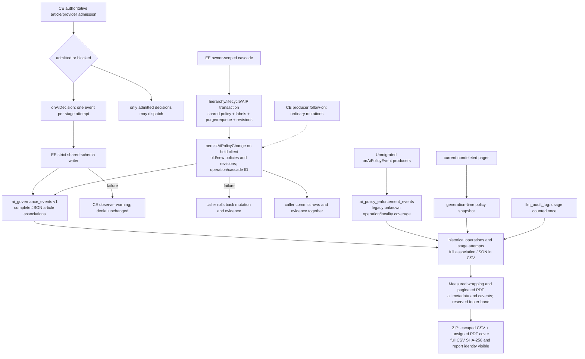

# 13. Article AI policy audit flow

Strict shared `AiDecisionEvent` and `AiPolicyChangeEvent` schemas contain no
content, endpoint or usage fields. JSON arrays preserve every article association,
including policy/content revisions. Captured locality is never reconstructed from
current settings. Exact event replay is idempotent; reusing an ID for different
evidence fails. The held-client sink never commits, opens another transaction,
uses the pool or swallows failures. Cascade uses it now without duplicate legacy
emission. Ordinary CE producer invocation is a separate #280 follow-on, not
certified by the EE sink tests. Legacy producers remain explicitly legacy.

Decision delivery is best effort with surfaced observer warnings; failed delivery
never permits a denied dispatch. No automatic retention duration is configured
for the new table. Database administration, manual deletion and restores can
leave gaps. Schema installation and earliest retained rows are coverage bounds,
not completeness proofs. There is no browser execution observer. Provenance IDs
grant no page-read permission. Exported actor identifiers are pseudonymized.

> This report summarizes recorded application policy decisions. Locality is administrator-declared. It does not attest model execution, upstream forwarding, or absence of unrecorded/external egress.

See [enterprise hooks](./10-flow-enterprise-license.md),
[database schema](./06-data-model.md), and
[typed evidence schema](./14-ai-governance-evidence-schema.md).
License loss disables EE management, not enforcement of stored restrictions.
