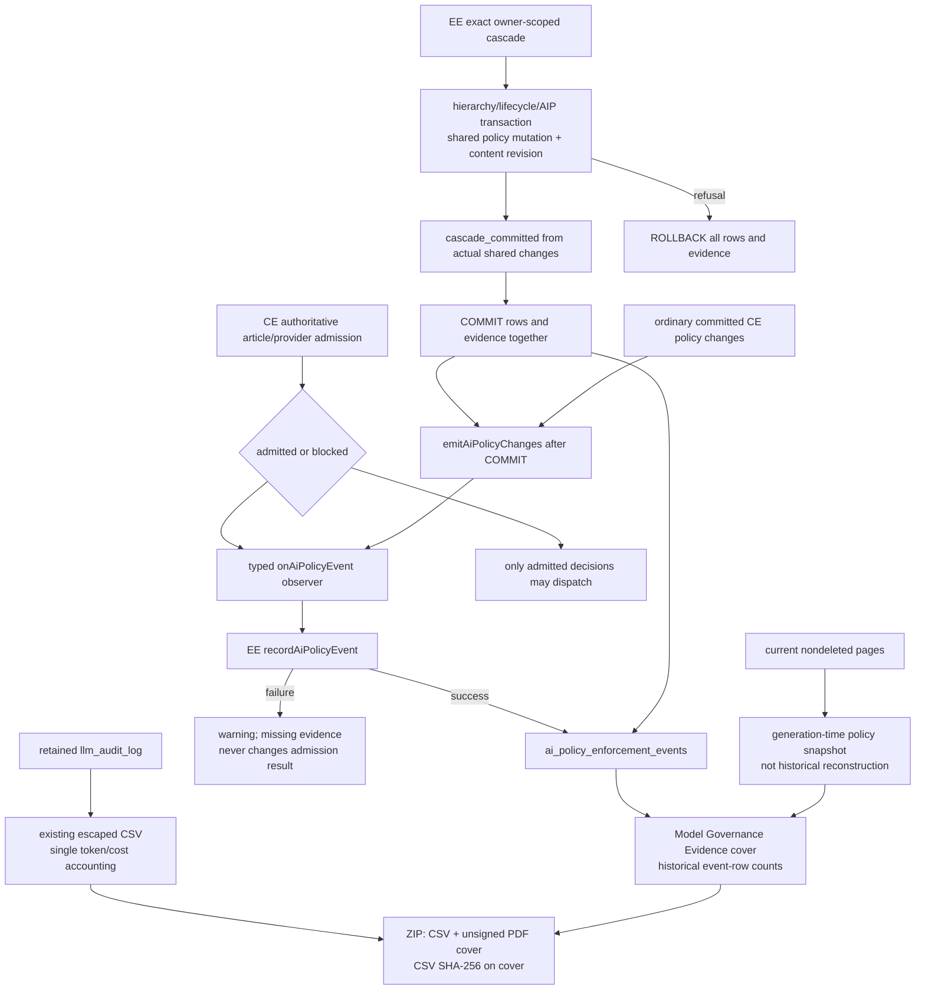

# 13. Article AI policy audit flow

The typed decision records store article/provider identifiers and available
revisions, never titles, prompts, completions, attachment bytes, credentials
or endpoint URLs. The policy observer does not create successful inference
rows or charge usage. Provenance identifiers grant no page-read permission.

Cascade records are transactional; normal policy/decision recording is a
best-effort asynchronous observer, not a durable retry system. These are
application records subject to database administration and retention, not
immutable or cryptographically attested logs. Missing locality, blocked-event
revisions, operation identities and complete mixed-article associations are
unknown. Counts are event rows, not distinct requests. No browser execution
observer exists. Retained gaps are not reconstructed from current settings.
Unreadable event/page sections are explicitly unavailable, not zero.

The report carries this exact limitation:

> This report summarizes recorded application policy decisions. Locality is administrator-declared. It does not attest model execution, upstream forwarding, or absence of unrecorded/external egress.

See [enterprise hooks](./10-flow-enterprise-license.md) and
[database schema](./06-data-model.md). CE hooks remain inert without EE; stored
article restrictions remain enforced after license loss.
