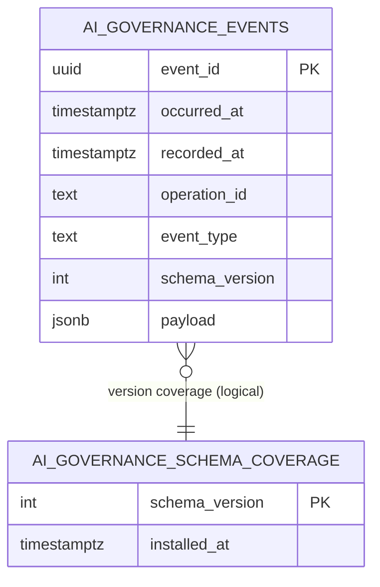

# Typed governance evidence data model (EE migration 931)

`payload` is the complete strict shared `AiDecisionEvent` or
`AiPolicyChangeEvent` object. Decision arrays associate every contributing
article's page ID, policy, policy revision and content revision; change arrays
carry exact old/new values and revisions. The envelope records operation/event
identity, timestamp, actor kind/ID, source and cascade identity. Decisions add
stage/attempt, outcome/reason and actual provider ID, configuration revision,
declared/effective locality. Null remains unknown. There are no token, prompt,
title, image, credential or endpoint fields. One event is one stage attempt,
not one row per article. Distinct operation counts are independent of arrays.

No foreign key to current pages, providers or users rewrites historical records
on deletion. A JSONB association is equivalent to an event-to-article relation
for complete exports; the report never collapses it to one policy. UUID event
identity is unique and exact replay is idempotent. The writer refuses conflicting
reuse. Application validation checks the strict schema before persistence and
again on export; malformed retained objects export only an unknown marker.

The legacy migration-930 table is retained unchanged and labelled separately;
its missing fields are never invented by a backfill. Migration 931 also supplies
the `all` SQL creation default for spaces without changing saved defaults or
existing articles. The new tables have no automatic retention policy; manual
administration and backup restores can remove evidence. They are not immutable.
