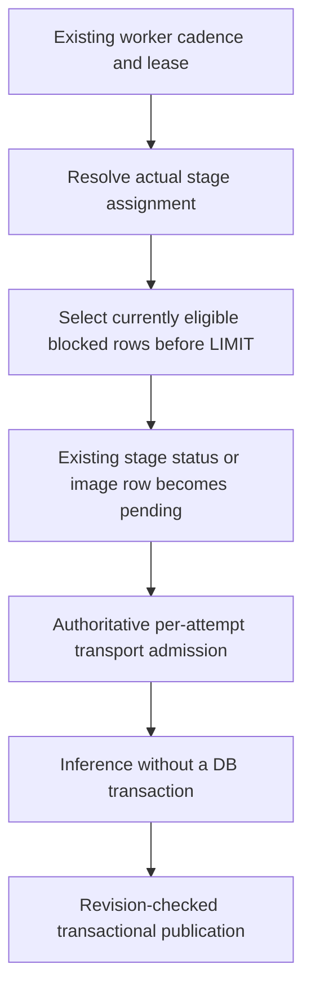

# Article-policy worker recovery and shadow coverage

Activation remains closed until every epic slice is accepted; these changes do
not enable the rollout gate.

Recovery uses the stage's own blocked status, not the shared page reason field.
An external provider leaves local-only rows parked; eligible rows behind those
rows can enter the bounded window. Missing/unreadable provider metadata leaves
work parked. Recovery selection is not an admission: assignment, policy, content
and provider changes are checked again at dispatch and publication. Vision
recovery runs only after the explicit assignment, capability and retained-identity
gates; it never inherits a text destination.

Shadow readiness checks local-only eligibility independently of whether candidate
vectors are filled or absent. Swap rechecks under the schema/page lock and a
provider row lock. Post-swap rollback checks the restored provider too, including
the current default for an inherited assignment. Refusals name a count, not page
titles; choose a permitted candidate or change article policy through its
authorized flow. Backfilled coverage excludes policy-blocked populations.

Embedding status exposes blocked population and reason counts under the existing
visibility predicate. Bulk auto-tag refusals count separately from provider
errors. A blocked decision is not an inference or a token charge. Already sent
bytes cannot be recalled; late results are rejected, not evidence of zero egress.
