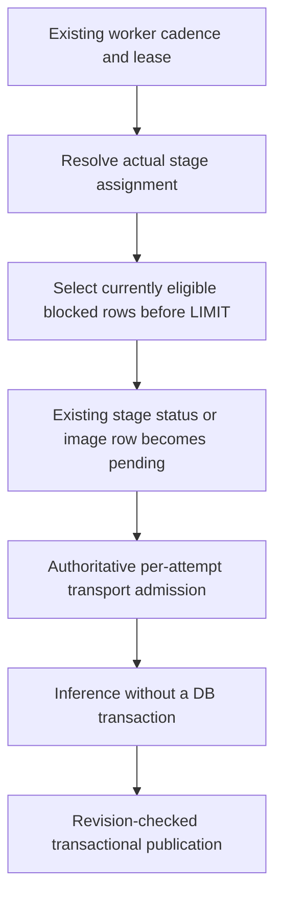

# Article-policy worker recovery and shadow coverage

Activation remains closed until every epic slice is accepted; these changes do
not enable the rollout gate.

Recovery uses the stage's own blocked status, not the shared page reason field.
An external provider leaves local-only rows parked; eligible rows behind those
rows can enter the bounded window. Missing/unreadable provider metadata leaves
work parked. Recovery selection is not an admission: assignment, policy, content
and provider changes are checked again at dispatch and publication. Vision
recovery runs only after the explicit assignment, capability and retained-identity
gates; it never inherits a text destination. Observing a changed provider
configuration revision resets its dispatcher and circuit breaker even when the
cache bus missed the event; reconnect additionally clears unassigned resources.

Published embedding input is distinct from an unpublished editor draft. Draft
save/discard records a bounded, server-owned xmin continuity receipt in the
existing settings store, on the same short transaction as the draft write. It
contains only row identities, never content. The writer compares every non-draft
column before preserving that continuity and the embedding operation ordinal.
Dispatch and publication still check published title/body/space, policy and image
revisions and the uninterrupted row chain. A newer claim/reset before or after a
draft save breaks the chain, even if the new claim writes the same status. Other
article stages and interactive provenance retain strict content-revision checks.
No transaction spans inference and no migration or second queue is introduced.

Live and candidate publication are independent: a candidate-only provider/model
change discards candidate vectors without discarding valid live vectors. A source,
policy, image or claim change rejects both, and a schema epoch change still defers
the whole publication. Bulk Confluence refresh consumes reserved labels through
the same tighten-only publication primitive as sync, including durable deferral
while rollout is closed; it makes no additional upstream call.

Shadow readiness checks local-only eligibility independently of whether candidate
vectors are filled or absent. Swap rechecks under the schema/page lock and a
provider row lock. Post-swap rollback checks the restored provider too, including
the current default for an inherited assignment. Refusals name a count, not page
titles; choose a permitted candidate or change article policy through its
authorized flow. Backfilled coverage excludes policy-blocked populations.

Embedding status exposes blocked population and reason counts under the existing
visibility predicate. Bulk auto-tag refusals count separately from provider
errors. A blocked decision is not an inference or a token charge. Already sent
bytes cannot be recalled; late results are rejected, not evidence of zero egress.
