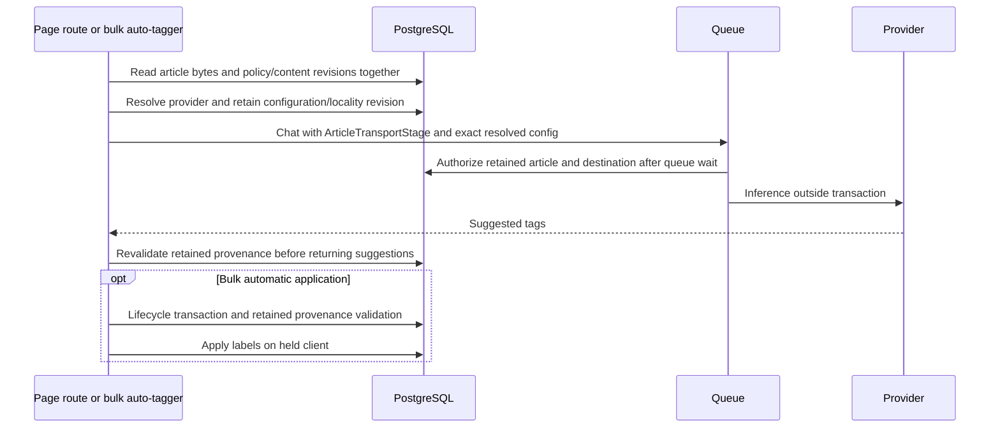
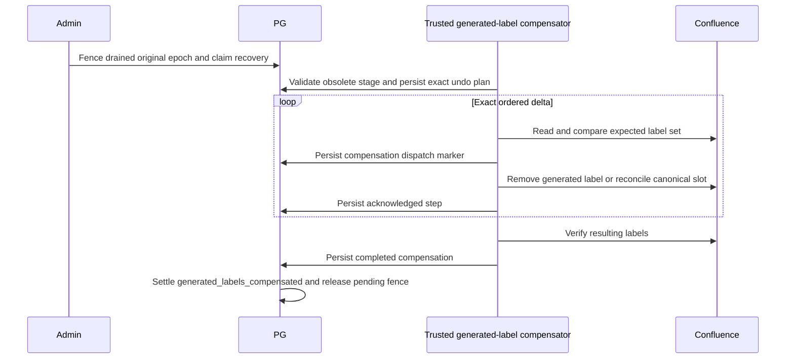

# Auto-tag article admission and publication

The article path never re-resolves its retained provider after admission. The
existing model override and classification input limit remain unchanged.
Known policy denial is a shared 403; unavailable/stale stage admission is a
shared 503 rather than a provider 502. A queued request is not admitted until
its concrete transport performs the check. Ordinary apply-tags remains an
authored label action, not a certificate for arbitrary client provenance.

Automatic bulk tagging uses the same article snapshot as interactive suggestion.
It validates policy/content/provider revisions on the lifecycle transaction
before publishing labels. For Confluence it validates at remote admission and
again at local mirror completion, without holding database locks during HTTP.
The retained stage includes the concrete model and model-selection intent, not
credentials. Publication compares the current held-client effective assignment
with that model/provider/configuration before checking article provenance. This
also catches same-provider model changes. The durable label intent stores this
stage; recovery revalidates it before publishing any generated output locally.
A generated-label intent with durable proof that remote dispatch never started
settles as `reconciled_not_applied` without validating obsolete AI authority and
without restoring `priorLabels`. This writer has not yet changed local labels,
so settlement preserves the current labels, policy, revisions and authored body.
The existing administrator-authorized recovery API still requires an original
runtime fence, current page access and matching content/lifecycle revisions.
Its terminal no-start proof releases the pending fence; a repeated recovery
refuses the already-settled intent rather than replaying any labels.
`auto-tag-no-dispatch-recovery.db.test.ts` exercises that API with actual runtime
quiescence/fencing and a new module-graph writer epoch, using real PostgreSQL.
This narrow regression does not prove the public policy-transition race or
acknowledged-effect compensation path.

Each remote label call has a short preflight transaction; HTTP runs only after
that transaction closes. Previously dispatched upstream effects cannot be
recalled; a later refusal leaves the existing intent unresolved rather than
certifying a stale mirror.

An acknowledged `page.labels` effect carrying retained generated-stage identity
now has a separate trusted compensation capability. Generic terminal-only and
conditional recovery modes are unchanged. After administrator authorization,
quiescence, original-epoch fencing and a single durable recovery claim, the
compensator plans an additive-effect undo in `page_generated_label_compensations`
(migration 140). It removes only newly generated ordinary labels and reconciles
the canonical slot to current policy. It never restores historical human labels.
Each remote step runs outside PostgreSQL transactions, between durable dispatch
and acknowledgement markers. Original remote receipts remain untouched.
An unacknowledged compensation step stays conflicted; observed labels alone do
not prove that an uncertain remote operation terminated. A known acknowledged
step can resume after a later settlement failure. Independent label changes
refuse compensation instead of replacing the whole upstream set.

The public policy setter can restrict an article while its generated-label
request is started but unacknowledged, before recovery starts. Migration 141
retains the original runtime, revisions, exact effect and PostgreSQL-precision
start timestamp in `page_generated_label_supersessions`. Only the original
running callback's private start snapshot can acknowledge that exact outcome;
this is not an exported completion bypass. The acknowledgment does not publish
labels. Ordinary writes, relaxation, another writer, and another phase cannot
use it. Policy, purge, supersession receipt and recovery-token advancement
commit together. The original AI provenance remains invalid after relaxation.
Other pending remote work continues to block policy writes. Fresh generated
publication reads upstream ordinary labels before writing, refuses conflicting
human changes, and synchronizes the current canonical policy slot.

Real PostgreSQL/HTTP tests cover model/configuration supersession, independent
remote-label conflict, interrupted settlement, durable compensation evidence,
original receipt preservation, and fresh inference. The genuine licensed EE
fixture additionally exercises public restriction, compensation and relaxation
with authored body/FTS preservation. The EE fixture holds an actual Confluence
response before acknowledgment, restricts through the public policy endpoint,
and uses the registered administrator HTTP quiesce/fence/reconcile endpoints
across a new writer epoch. It verifies unauthenticated and non-admin refusal,
blocked relaxation and ordinary writes, stale local publication, durable repair,
and fresh inference after relaxation. Migration 142 adds an ordered request
journal (`page_generated_label_requests`): every add/remove has its original
runtime, actor, immutable intent effect (including retained AI destination),
revisions, exact before/after label sets, dispatch timestamp and independently
nullable acknowledgment. The per-request start transaction revalidates retained
authority. HTTP is outside it. Only the original running callback acknowledges
its exact request, including after an exact policy supersession. A later refused
preflight leaves the acknowledged prefix intact and does not mark the whole
remote phase complete. An unknown dispatched request keeps recovery closed.
The compensator starts from the acknowledged prefix's actual resulting set,
not the unexecuted final target. Independent upstream edits still conflict.

The genuine EE lifecycle fixture covers restriction while the add response is
held before a removal, and while the first removal response is held before a
second removal. The next request is never sent. Both cases exercise durable
prefix receipts, interrupted/repeated administrator recovery, canonical policy
labels, authored body/FTS preservation, stale-stage refusal and fresh inference
after public relaxation. These cases pass with production readiness default OFF;
only the real licensed fixture opts in. The full entry-point matrix remains
separate verification work.

Real PostgreSQL tests use an HTTP provider boundary, exercise policy/content/
endpoint changes during inference, policy changes during queue wait, and a
content change between result validation and local label publication.

`autoTagContent` requires an article stage: omission is a type error, and
runtime omission, an empty article set, a different actor/use case, or a
non-article marker is refused before provider resolution and before HTTP.
There is no non-article auto-tagging exception. Its production caller is
`autoTagPage`, which loads server-derived provenance; tests of input preparation
and provider errors now enter through that persisted-article path. The HTTP
boundary regression also checks omission and a non-article marker send nothing.

This is not rollout activation. The shared transport still has optional stage
parameters pending the all-caller cutover. Worker batch status settlement,
legacy decision evidence, and open-readiness publication proofs remain separate
work. Restrictive activation remains closed.
