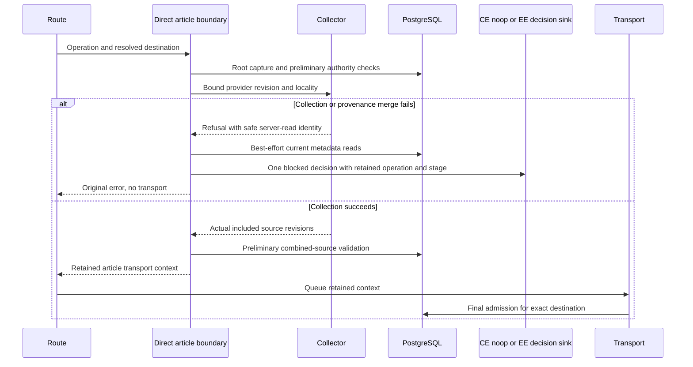

# Direct article collection refusal evidence

The shared `assembleDirectArticleContext` boundary is used by Improve,
Summarize and Quality. Preliminary admissions authorize collection without
recording a completed inference admission. A collector exception is therefore
an independently owned refusal, not an exception that can simply escape to the
route's stream-slot cleanup.

Only collection and provenance merge are caught here. Root capture and both
preliminary/final admissions own their refusal events; wrapping those calls
would duplicate the same stage attempt. Collector errors carry only a
server-read descendant ID where available, never titles or content. Fresh
metadata reads populate evidence; failed reads remain null rather than copying
stale authority. The concrete resolved model and operation/stage/attempt are
retained. Evidence dispatch uses the inert CE hook and the genuine EE sink.
Persistence is best effort for decisions: an unavailable evidence store can
leave a bounded gap, never permission to dispatch or proof of no execution.

The route audit covers allocation before resolver failures, root capture,
collection, merging sources, cache waiting and queued dispatch. Improve,
Summarize and Quality share this boundary; Diagram and server Inline use the
root-only boundary. Cache hits revalidate after waiting and do not count as
inference. The final transport owns final refusal and successful admission;
refusal-aware stream accounting does not create token usage for it. Generate's
new-article/free-form path is explicitly non-article and does not certify pasted
content. Ordinary input-validation, rate-limit and attachment-staging failures
are not successful inference decisions.

Licensed real-PostgreSQL/Redis tests exercise all three composition routes with
endpoint drift, locality drift, unsafe descendant revisions and a restriction
committed after collection. They observe the real outbound HTTP peer, persisted
typed events and governance report rows, asserting exactly one blocked decision,
no provider bytes, no usage or legacy duplicate, and no authored content or
endpoint in decision metadata. The post-collection cases prove admission-owned
refusals are not duplicated by the collection catch. Production activation is
unchanged and remains default closed. This is application evidence, not
execution attestation, universal DLP or proof of zero egress.
