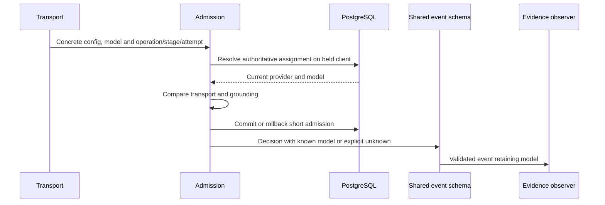

# Decision-time model evidence

`AiDecisionEvent.provider.model` records the concrete receiving model established by the held-client resolver, never a subsequent assignment lookup. The new-event type and `AiDecisionObservationSchema` require this field whenever a provider object is present, with null representing unknown. `emitAiDecision` validates that stricter observation contract before invoking the sink. The historical `AiDecisionEventSchema` decoder remains lossless for legacy records that omit the field: it neither rewrites persisted payloads nor certifies their model completeness. Neither decoder fills missing evidence from today's configuration.

A changed model on the same provider is recorded as the current model on a blocked dispatch. A different resolved provider does not attribute its model to the original provider. Publication-only checks do not represent another inference and must use publication mode rather than emit another admitted decision.

`article-stage-admission.db.test.ts` covers actual receiving-model evidence and provider/content revision fences using PostgreSQL. `ai-governance-model.test.ts` covers known-model serialization, legacy admitted/blocked unknowns, empty-model rejection and the required output field at compile time. The shared boundary preserves model evidence for consumers; EE CSV projection must separately retain it. This document does not claim inspection or correction of that out-of-scope projection.

Production activation remains closed by default. Evidence describes application authorization, not execution attestation, endpoint residency, zero egress, or the ability to recall bytes already sent. Keep enforcement or pause AI during rollback; never drop restrictions to regain service.
