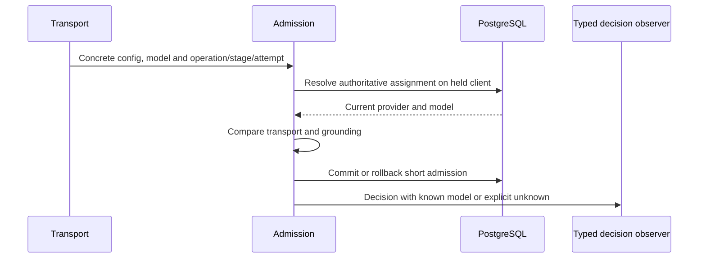

# Decision-time model evidence

`AiDecisionEvent.provider.model` records the concrete model read by the held-client resolver, not a subsequent assignment lookup. It is null for an unknown destination/binding or a publication-only check without model resolution; older records may omit it. A changed model on the same provider is recorded as the current model on a blocked dispatch. A different resolved provider does not attribute its model to the original provider.

The real-PostgreSQL `article-stage-admission.db.test.ts` exercises allowed first-model dispatch admission and blocked same-provider second-model assignment, preserving operation identity and distinct event identities. It checks that the title and endpoint URL do not enter the emitted event. The existing queued-endpoint and SQL-error scenarios remain in that suite. All eight full review gates passed after this correction (backend: 481 files, 7499 passed, four skipped; overlay: 98 files, 1519 passed). These results are regression evidence, not complete requirement-slice acceptance.

## Remaining cutover work

The legacy `AiPolicyEvent` / `emitAiPolicyEvent` / `onAiPolicyEvent` path still exists in the preflight admission helpers and EE governance service. Those records do not implement the complete typed operation/stage contract. Direct composition also currently invokes multiple typed admission checks before final outbound admission for the same attempt. Complete producer migration, single-attempt counting, and genuine EE readback of the complete decision model remain outstanding. This model-field correction does not close F280-typed-evidence-contract or the overall coverage finding.

SPEC-CORE-001 schema/default/constraint definitions and SPEC-CORE-002 shared authority/label/revision/creation code were inspected, but this review does not independently establish their entire public acceptance matrix. SPEC-CORE-003 final dispatch still checks actual transport, policy/content/provider revisions and scoped resolver overrides; its evidence cutover remains incomplete as above. Existing verified repairs are retained, not replaced by this document.

Production activation remains closed by default. Decision evidence describes application authorization, not proof of execution, endpoint residency, zero egress, or the ability to recall bytes already sent. Keep enforcement or pause AI during rollback; do not drop restrictions to regain service.
