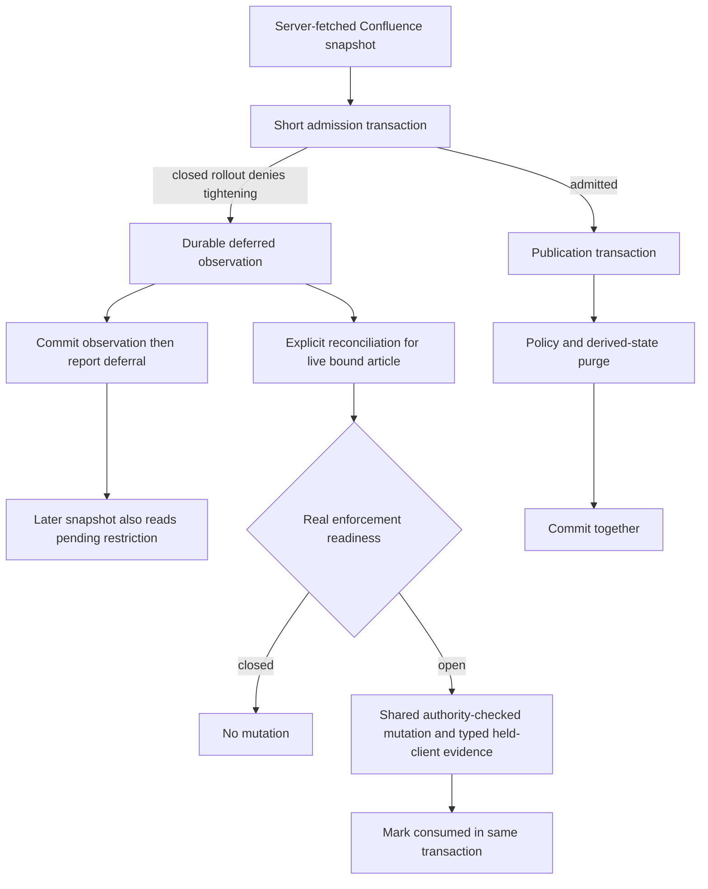

# Deferred ingestion restriction observations

Migration 139 adds `ai_policy_deferred_ingestion`. These are pending source
observations, NOT applied article policies and never dispatch authorization.
The record contains only source identity, upstream revision, policy, actor and
observation/application timestamps. It contains no titles, bodies or secrets.
Confluence uses its existing shared identifier namespace; Notion records use
an owner-scoped namespace. Applied rows retain a nullable reference to the
article (hard deletion clears that reference, not the observation).

`observeIngestionAdmission` commits a deferred decision with its observation,
then throws the deferral. A later upstream label removal cannot erase a
pending observation. Confluence performs this before attachment side effects.
Its upsert and conflict-update paths now purge restricted derived data on the
publication client before COMMIT; a purge failure rolls publication back.
Existing-row upserts and HTML-conflict updates now take the policy advisory
lock before the row lock and call `publishIngestionPolicyOnClient` on that
same transaction. Content SQL preserves the stored policy's canonical label
until that publisher performs the authority-checked mutation. The sync actor
is passed explicitly; absent legacy internal actors cannot authorize a move.

The genuine licensed EE test exercises native `syncPage` for same-version
HTML drift and a new-version upsert: closed rollout defers, a database evidence
constraint failure rolls back content/policy/observation consumption, and a
successful retry records one policy change. These tests use a stub upstream
client and real PostgreSQL. They are not HTTP-route or journal-recovery proofs;
bound-journal fresh publication now also calls `publishCreatedConfluencePage`
on the held sync transaction after exact snapshot/journal admission. That
publisher inserts neutral and applies the creator's policy through the common
revision/purge/evidence writer, attributed to the creator rather than the sync
walker. The following content upsert preserves that committed-in-transaction
policy. Ordinary stricter upstream/default input still needs ordinary admission.
A new genuine licensed `syncUser` regression proves evidence failure rolls back
the new row, retry records one change, and later relaxation survives another
sync. It substitutes upstream client methods only.

The licensed runtime suite additionally exercises actual `POST /api/sync`,
`GET /api/sync/status`, policy mutation and
`POST /api/admin/page-write-recovery/intents/:intentId/reconcile` routes with
signed authentication, real PostgreSQL and an upstream HTTP fixture. It covers
fresh and unchanged-body deferral, upstream label removal, enabled consumption,
evidence-failure rollback, exact retries and subsequent authorized relaxation.
Bound creation journals are adopted through public sync with readiness closed.
Public reconciliation covers fresh and sync-first rows, atomic evidence failure
and retry, terminal settlement, and preservation of later relaxation. A creator
whose parent policy authority is revoked retains read access but cannot publish
through either public sync or reconciliation. Recovery fixtures seed a retired,
quiescence-acknowledged predecessor epoch and use the real fencing service; they
do not claim to exercise process shutdown or the runtime-fencing HTTP endpoint.
No readiness hook or persistence layer is mocked.

`reconcileDeferredIngestionPolicy` is an explicit core entry point for a live
source-bound target. It checks real readiness (not a caller-supplied bypass),
takes the existing write fence, and applies only the stricter of current policy
and pending observations through `applyAiPolicyOnClient`. Authority failures
roll back. Typed policy-change evidence and consumption commit with the policy.
Consumed observations cannot override a subsequent explicit relaxation.
Observation lookup/insertion and reconciliation now canonicalize Notion source
IDs at the core boundary (lowercase, without hyphens), including the stored
`pages.notion_page_id` comparison. A dashed or uppercase API identity must not
miss an undashed deferred record. The owner scope remains exact; Confluence
identifiers remain opaque and are not normalized. This identity correction
alone does not establish open-readiness publication/consumption correctness.

## Rollout status and remaining work

Restrictive activation remains CLOSED. This is not a rollout-complete claim.
Notion's production importer now records deferred decisions before placeholder
allocation or attachment effects. Its owner-scoped source ID is normalized
(lowercase, without hyphens); `last_edited_time` identifies the upstream
observation, with a snapshot digest for legacy responses lacking that field.
Retries merge pending observations even if upstream removes the policy label.
Real-PostgreSQL tests with a fake HTTP Notion server cover both fresh and
existing targets, preserving the original body and applied policy while closed.
The pending observation is not a successful import or applied restriction.
Notion now uses `publishIngestionPolicyOnClient` for policy mutation rather than
assigning policy in content SQL. Fresh placeholders start neutral within their
creation transaction, then apply policy through shared authority and evidence.
Placeholder creation deliberately retains pending observations: attachment
failure may delete the placeholder. The final body transaction consumes them;
reimport and explicit reconciliation use the same held-client primitive.
Policy advisory locks precede the finalization callback's target row locks.

This is a bounded correction, not completed activation work. Confluence fresh
publication now uses the shared writers, including bound-journal adoption.
The licensed helper, sync-worker and public-route scenarios prove bounded
exactly-once, subsequent-relaxation and evidence-failure behavior. They do not
establish universal provider transport authorization or complete typed evidence
for every AI operation. Label-only unchanged-body
sync now enters the held-client publisher before its fast return; live-collab,
manual-review and keep-local content branches also publish policy independently
of the decision to retain authored content. Already-imported non-overwrite
Notion jobs enter observation planning and a lifecycle-fenced policy-only
transaction without replacing their bodies or unrelated labels. The genuine
licensed tests cover non-overwrite import against a fake HTTP Notion server and
unchanged-body sync through syncUser, including closed deferral, evidence failure
rollback and exact retry. Public Notion import tests also cover folded/table
policy contributions to receiving articles and a concurrent completed-row insert
collision. These bounded publication proofs are not universal ingestion or
activation acceptance.
Tests exercise real closed readiness, fresh-row rollback with pending intent
preserved, durable observations and Confluence purge failure rollback without
fabricating deployment readiness. Do not enable restrictive rollout based on
these tests alone.

Operators must preserve this table across upgrades and backups. Do not delete
pending observations merely because upstream labels have changed. Do not expose
pending policy as applied policy in API/UI/report snapshots. Once restrictions
are active, rollback must retain enforcement or pause AI; never drop policy or
observation data or reclassify articles to restore service. A failed purge must
be retried as a complete transaction, not accepted as successful publication.

This governs supported application paths, not arbitrary pasted copies, bytes
already dispatched, operator proxies, or modified clients. It is not residency
attestation, universal DLP, or a zero-egress guarantee.
