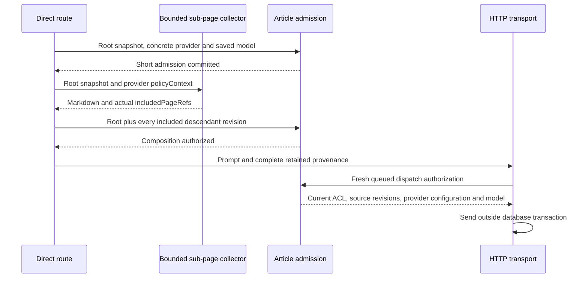

# Direct article sub-page composition

Improve, Summarize and Quality resolve their existing saved use-case destination
before composing. `assembleDirectArticleContext` captures the root title and
policy/content revisions together, checks its ACL and destination, then calls
`assembleContextIfNeeded` with the collector's provider-bound `policyContext`.
The existing breadth-first collector retains its depth, page and character limits.
It filters descendants before formatting titles or bodies; omitted descendants
are never described in the prompt. Display-only collector calls are unchanged.

Composition checks emit refusals, not preliminary admitted decisions. The
Summarize route records its one admitted decision at the queued HTTP dispatch,
not before cache lookup. A cache hit revalidates the complete retained source
set after the cache wait, without counting a new inference; a denying check
still emits its typed refusal. The genuine EE first-publication fixture calls
the public summarize route with a child page and then replays the cached result:
one outbound request, one persisted admitted stage attempt, both article IDs.

Partially truncated descendants still contribute provenance. Repeated identities
must agree on their revisions. The collector includes authored HTML only, not
stored image-analysis payloads or generated summaries; those cannot be silently
certified by the root. Changes to any included policy, content revision, ACL,
provider endpoint or saved model between composition and dispatch refuse the
call without outbound inference. Inaccessible roots remain 404, indistinguishable
from missing roots, rather than treating their drafts as unrestricted input.

Improve and Diagram allocate their request operation in `_article-resolution`
before resolving chat. A resolver failure records one typed unavailable decision
under that operation, with a server-resolved visible article when available and
an unknown destination. Success retains the operation through composition and
the queued transport, without emitting a preliminary admission. Both routes
revalidate cached results after the Redis stampede wait. Improve passes audit
metadata to the refusal-aware stream helper rather than recording unconditional
success after a swallowed stream refusal; a blocked dispatch has no usage row.

The genuine signed-license runtime suite exercises both public route handlers
against PostgreSQL, Redis and an HTTP model peer. It reads persisted decisions
back through the evidence report, checks distinct request operations, one
admission on a cache miss and no additional inference on a hit, and deterministically
tightens policy during cache polling and immediately before queued dispatch.
The observer spies delegate to the real cache methods; no persistence or
policy/resolver service is replaced. Neither race emits model bytes or usage.

This change does not activate restrictive policy writes or claim complete epic
coverage. Production readiness remains default-off. In-flight bytes cannot be
recalled; manually pasted unrelated text and hostile clients remain outside the
application association guarantee.
