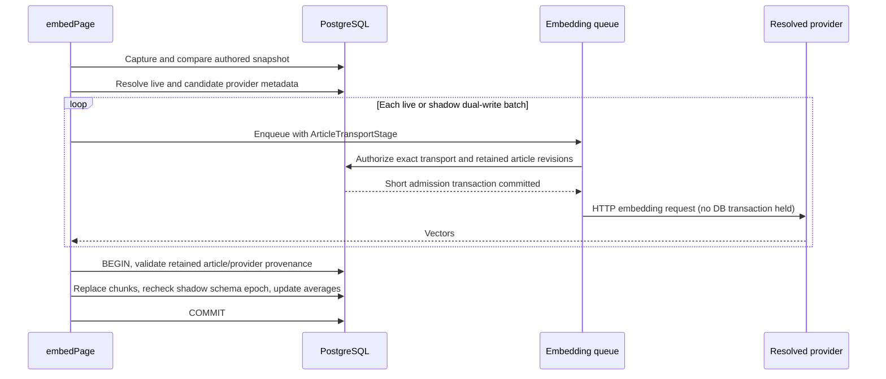

# Article embedding admission and publication

`embedPage` captures the current article policy/content revisions before composing
chunks. The supplied title, body and space must match that row: an obsolete
queued body is not certified with a newer revision.

The dirty scan claims each page separately using the captured PostgreSQL row
version (`xmin`), rather than batch-updating selected IDs. The retained snapshot
also includes `image_analysis_revision`. Dispatch checks these internal versions
after the queue wait; publication, ordinary failure, breaker-retry failure and
unfinished-claim cleanup refuse a successor row. These internal tokens are not
wire provenance or permission. A reset creates a successor version and preserves
policy-blocked rows; provider-related blocks remain eligible for normal rechecks.

Live publication additionally resolves the effective embedding assignment on its
held transaction client and compares provider, configuration revision and model.
A changed image-analysis revision rejects the entire vector replacement, not
just the dirty-flag clear. Relationship computation locks page rows before edge
writes and excludes prohibited sources and neighbors, serializing against purge.

Publication takes the shared policy advisory lock and page/provider row locks
on the same client used for replacing vectors. Policy/content/provider changes
reject the whole replacement; a failed candidate embedding leaves shadow vectors
absent rather than borrowing authorization from the live destination. Each batch
is a new admission after queue wait. A denied later batch discards the accumulated
vectors. The existing shadow epoch check remains independent of article policy.

The HTTP-boundary PostgreSQL suite covers allowed embedding, stale input,
policy/content/provider changes during inference, and denial of a later batch.
Legacy composition and shadow fixtures now persist their input before invoking
the worker, instead of passing content that is not the saved article.

The separate shadow backfill runner now retains an article snapshot and passes
an ArticleTransportStage for each queued batch. Its provider configuration carries
the revision read with the endpoint, including for live dual-write candidates.
Both backfill and dual-write publication use `validateEmbeddingPublicationOnClient`.
The helper validates the active candidate assignment (provider and model) under a
held state-row lock, then the provider configuration, article policy/content,
image-analysis revision and PostgreSQL claim version. Schema locks precede the
candidate row lock so swap/abort cannot rename columns between validation and
publication. The independent migration epoch is still checked. Shadow averages,
like live averages, exclude image-analysis vectors. Refusals remain blocked
stragglers, not completed work or provider failures. PostgreSQL HTTP-boundary
cases cover candidate/model replacement, endpoint changes, derived revision and
claim supersession as well as policy/content/epoch changes and later batches.

The genuine EE quota/inference harness additionally enables the real readiness
hook with a signed fixture license and fixture-only operator flag. While HTTP
embedding results are held, the public policy endpoint commits the owner's
restriction. Tests cover live, backfill and context-length/nonvector outcomes,
including derived image input. They assert vector/average/image payload and
similarity-edge removal, preserved authored body and lexical `tsv` matches, and
refusal of stale publication. A database trigger that fails the final purge
statement proves the earlier policy/vector writes roll back together. Public
relaxation followed by the real dirty worker publishes fresh live/shadow vectors,
completes without repeated dispatch, and rejects old retained settlement tokens.
Authentication alone is substituted by that harness; persistence, resolver,
policy authority, readiness and workers are real.

This is not activation evidence. Ordinary failure/short-page settlement, legacy
chunk provenance, auto-tag consumers, mandatory transport context cutover and
legacy decision evidence still require their own verification. Restrictions
remain closed for activation. Already-sent bytes cannot be recalled.
