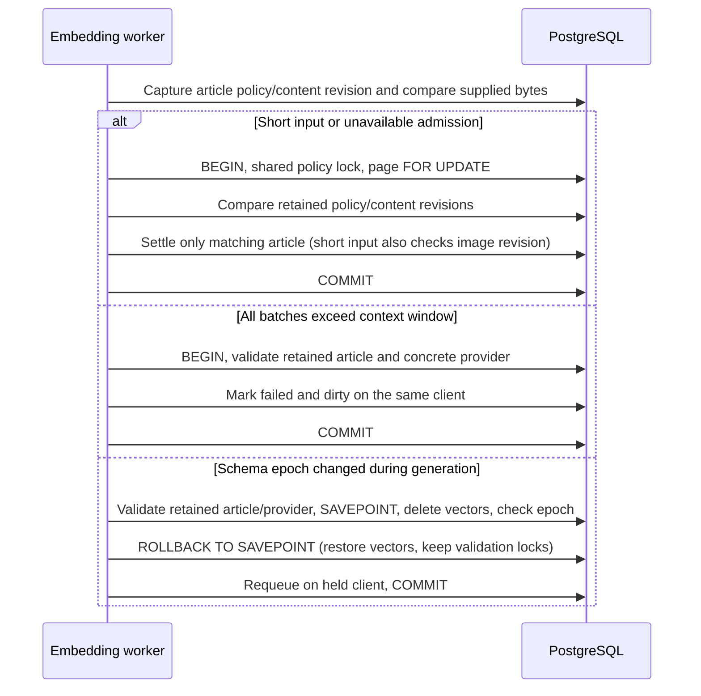

# Embedding non-vector settlement

Embedding completion is not limited to vector insertion. A short-input decision,
a context-window rejection and a schema-epoch requeue also change live work state.

An early persistable denial is re-evaluated by `publishCurrentAiPolicyBlock`
under article/provider locks, with retained content and policy revisions checked
before the status write. An unavailable admission has no provable destination:
it does not fabricate a provider declaration or a successful inference.

The PostgreSQL settlement tests cover unchanged, changed content, changed policy
and deleted articles. HTTP-boundary publication tests cover context-window
failures with concurrent article/provider changes. The composition regression
checks that an intervening image-analysis revision remains dirty.

This is a bounded repair, not activation evidence. The dirty-page orchestration
still has unguarded generic failure and batch-start status writes. Mandatory
transport context and legacy evidence migration remain outstanding. Restrictive
activation stays closed, no sent bytes can be recalled.
