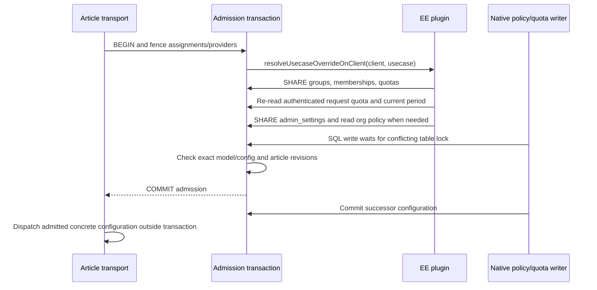

# Authoritative enterprise destination resolution

Article dispatch resolves the saved CE assignment and the real EE override on
one short PostgreSQL admission transaction. No network inference runs while
these locks are held. The namespace-loaded plugin exports both resolver hooks;
the ordinary resolver remains a planning step, never dispatch authorization.

The quota request context retains the authenticated identity from quota
evaluation, not authority from its cached degrade result. Dispatch re-evaluates
membership, budget, current period and fallback. Expired periods are treated as
zero usage without updating under a SHARE fence; the existing accounting path
persists rollover. Accounting now holds groups/memberships in SHARE mode and
locks the selected quota rows in group-ID order on one checked-out client.
Period reset and token debit commit together for exactly that selection; a
membership change cannot substitute an unreset quota between the two operations.
Concurrent debits serialize on the quota rows, and failure on any selected group
rolls back all resets and debits. Real PostgreSQL tests exercise concurrent
rollover/debits, a blocked membership replacement, and an injected second-group
write failure. This is accounting at completion, not a reservation of tokens at
admission. A hard block, unreadable configuration or incomplete active
organization policy refuses dispatch. Department degradation applies only to
text use cases; embedding retains organization policy, and explicit-only rerank
and image analysis do not inherit a text override.

Native quota upserts, deletes, usage debits, resets and membership writes acquire
PostgreSQL ROW EXCLUSIVE locks automatically, conflicting with admission's SHARE
locks even for previously absent rows. Organization partial writes now use one
transaction: provider SHARE followed by admin_settings SHARE ROW EXCLUSIVE,
read/merge/validate/write/commit. This serializes simultaneous partial changes
and avoids falling back to disabled defaults when validation cannot read state.

The fences cover tables rather than individual rows to include inserts and
absent settings. They are intentionally short and can delay unrelated settings
writers. These changes do not reserve future token usage, change the existing
per-process stream cap, or claim inference cancellation after admission.
Production restrictive-policy activation remains default-off. This resolver
implementation is not evidence that every epic dispatch/replay consumer is
complete.
