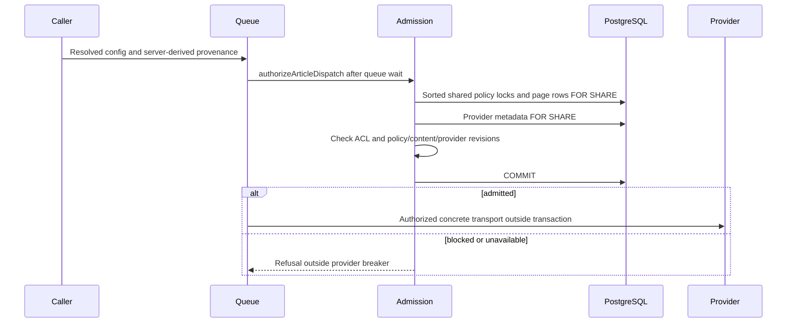
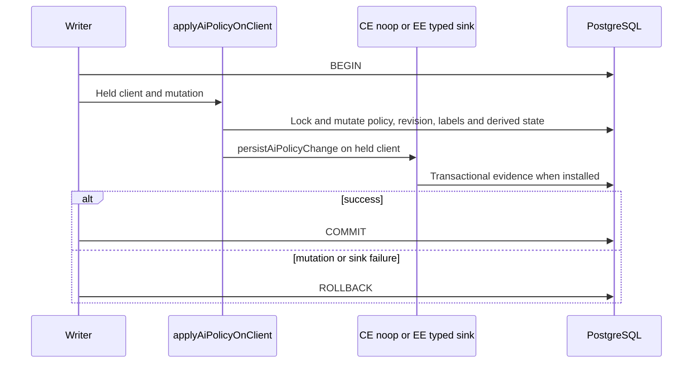
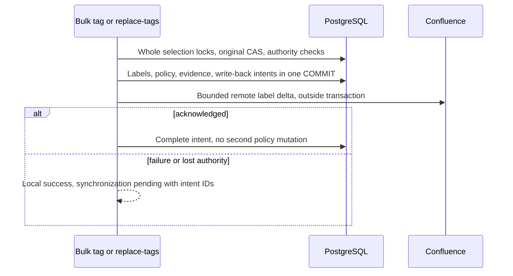

# Article AI governance foundation

## Authoritative receiving-stage interface

`ArticleTransportStage` binds an article-associated transport to server-derived
provenance and an operation/stage/attempt identity. Authorization never resolves
a different destination. Each retry and later batch needs a new admission.
`validateArticleStageOnClient` holds policy, page and provider locks through
publication on the publisher's transaction. Never run inference under them.
Unknown metadata cannot establish locality. Checkout and transaction-aborting
failures retain an unknown typed blocked decision. Publication is not another
inference admission, and blocked requests are not provider breaker failures.

## Early image denial publication

An image preflight denial is not permission to park the row later.
`publishCurrentAiPolicyBlock` reacquires the shared article policy lock, the
live page row and exact provider row before publishing the block on that same
client. It requires unchanged content revision and a current matching policy
decision. A concurrent relaxation or permitted declaration therefore leaves
work eligible rather than overwriting it with an obsolete block. The image
update also requires the selected attachment hash and an eligible work state;
only an actual update increments the blocked counter. Provider edits serialize
with this short transaction. No inference runs in it.

This addresses early denial publication only; success/failure publication and
final transport binding still require the worker migration described below.

## Policy change evidence

General page PUT, label writers, sync-first publication and recovery no longer
emit a second legacy policy_changed observation after commit. Recovery retains
its real invalidation and settlement work. Typed evidence becomes visible with
the policy, rolls back with settlement failure and is not repeated on an
idempotent sync-first replay. CE keeps its inert sink.

## Policy authority predicate

`canMutateAiPolicy` first requires a live page. System administrators retain
existing bypass; other actors must see the page. Standalone ownership grants
policy authority, but is not the only path for standalone articles: a visible
nonowner may hold exact scoped `edit`, with page ACE overrides respected.
Permission aliases such as `pages:edit` and shared visibility alone are not
policy authority. The PostgreSQL authority regression also exercises a real
scoped-editor relaxation through the revision-guarded service.

`applyPageLabelsOnClient` now invokes `assertLabelPolicyChangeOnClient` on
its locked row before publication. Both tightening and relaxing require this
predicate. Unchanged-policy ordinary tag edits remain allowed by their ordinary
ACL, including edits to already restricted articles. Route label planning now
uses the same shared guard rather than a relaxation-only authority branch,
including its structured refusal and closed-readiness checks. The remote
single-label writer uses the same guard before its first upstream call.

A new tightening is refused with 409 while rollout is closed. Label recovery
supplies its durable intent ID, not an allow boolean: the guard verifies a
pending acknowledged remote label intent, actor, exact page/Confluence identity,
original content/lifecycle revisions and exact target labels in PostgreSQL.
Only that previously dispatched operation may settle across closed readiness;
missing, undispatched, stale or unrelated receipts do not authorize activation.
Policy authority is still checked for recovery in either direction.

A supplied recovery ID is now validated even when readiness is open or the
planned policy is unchanged; neither condition certifies the journal. The
create-journal exception additionally compares exact initial labels and every
referenced content/lifecycle revision. A label-target mismatch retains the
existing terminal-evidence refusal. Unknown journals cannot authorize an
unchanged recovery publication. Real PostgreSQL regression coverage exercises
both readiness states without replacing persistence.

`applyAiPolicyOnClient` also enforces visibility for every live target and
policy authority for every actual move, regardless of `requireAuthority`.
That option only adds authority checks for explicit same-policy reassertion.
The complete selected set is checked before the first mutation. Tightening
now invokes the closed-rollout guard inside the primitive, after revision
validation and before policy, purge or evidence writes. Ordinary unchanged
saves and authorized relaxations remain possible.

Sync-first create recovery passes the actual journal ID. The primitive checks
acknowledgment, actor, remote identity/version, space/parent, initial policy and
content hashes; supplying only an actor no longer permits tightening. These
checks do not complete the automatic-ingestion and fresh-insert migration or
the whole-selection publication contract.

## Shared label refusal contract

The held-client label writer raises `AiPolicyDeniedError` for policy authority
failures. It remains a `PageWriteError` for lifecycle/recovery compatibility,
but carries the shared `ai_policy_denied` body and selected page IDs, recognized
by `isAiPolicyRefusal`. Routes need not reconstruct the denial from message
text. A missing/inaccessible target returned by the mutation primitive remains
404; stale revisions remain structured 409 conflicts rather than a generic
label-write conflict. Real PostgreSQL tests exercise both shared-viewer denial
and hidden-target publication refusal. This error-contract repair does not make
per-target remote bulk settlement atomic or authorize restrictive activation.

## Exact label decoding

Core reserved-label parsing delegates to the contracts normalizer. Both label
and input-alias lookups require an own property of their frozen table. Ordinary
labels such as `constructor` and `__proto__` must not become policy values,
vanish during canonicalization, or override a restrictive ingestion label.
The pure core and contract regressions exercise these names in both ingestion
orders. SQL's explicit CASE table already excludes them. Migration 138 and the
contracts helper now agree with core: every policy has one canonical label,
including `all-ai`. Real PostgreSQL tests compare all three policies across
fresh helper installation, upgrade from 136 and repeated installation.

This is helper convergence, not a completed writer rollout. Existing rows,
frozen snapshots and durable intent targets are not rewritten by migration
138. The existing-row interactive planner now validates the entire target,
including carried identities, and rejects contradictory policies. It uses the
shared contracts canonical helper for exactly one reserved slot matching the
resulting authority, including `all-ai`. A stale carried identity is not a new
policy command: it is repaired without changing policy or policy revision.
Real PostgreSQL regressions cover all three policies, stale/missing slots,
ordinary shared viewers, and rollback when a later target contradicts.
Generated auto-tag selection treats a canonical-only row as otherwise untagged;
its existing transport and publication checks still decide whether AI may run.
Legacy acknowledged remote targets without a canonical slot remain pending on
an exact-target mismatch rather than falsely claiming remote synchronization.
Compatibility/recovery coverage for those legacy targets is still outstanding. Interactive `/pages` creation now canonicalizes after resolving the
creation default and explicit choice, before either local insertion or the
durable Confluence intent. Thus ordinary creation includes `all-ai` without
mistaking that generated label for a conflicting input choice. Existing-row
planner changes still require coordinated writer and recovery handling: a canonical label cannot
be silently added to an already acknowledged remote target and then reported
as synchronized.

## Interactive creation admission

`resolveCreationAiPolicy` now defaults to interactive admission. It rejects
contradictory label/explicit choices and rejects a restrictive resolved result
with structured 409 `ai_policy_enforcement_unavailable` while activation is
closed. This includes label-only creation and restrictions from the creation
default, not just the explicit `aiPolicy` field. `/pages` calls this before
inserting a standalone page or reserving/dispatching a Confluence creation.
The real PostgreSQL/Redis HTTP regression checks all six restrictive label
spellings and verifies that neither pages nor intents change on refusal.

Ingestion explicitly requests planning mode: conflicting upstream labels still
resolve strictest-wins. This mode is not authorization to publish the result;
ingestion publication and the low-level mutation primitive still require the
all-writer authority/activation repair. Do not enable activation based on this
creation regression or interpret the planner as enforcement.

## Created Confluence publication

Before inserting a fresh restrictive row, `publishCreatedConfluencePage` now
requires a live actor with creation policy authority. Without recovery it also
requires rollout readiness. Recovery must match a pending acknowledged create
journal's actor, remote ID/version, space/parent, content hashes, exact labels
and policy, and the referenced parents' content/lifecycle revisions. Missing or
invented receipts refuse publication before INSERT. Existing rows retain the
identity comparison and shared policy mutation guard.

The public create route schedules its durable label step from resolved initial
labels, not the optional caller input. A no-label creation therefore writes
`all-ai` upstream too. This step remains outside the publication transaction;
its failure preserves local publication and leaves uncertain dispatched work
pending. The automatic-ingestion fence is still a separate, incomplete
admission boundary; this repair does not certify all fresh publication paths.

## Bulk label preflight

Both bulk/tag and bulk/replace-tags now plan the whole resolved selection
before starting per-page work or creating progress jobs and remote intents.
When any selected policy moves, the preflight takes the existing write fence,
sorted policy locks and row locks, checks the original content/lifecycle pairs,
and checks policy authority in either direction. An unresolved identifier
refuses the policy-bearing batch without disclosing a title. Restrictive
activation is refused while readiness is closed. Ordinary tag-only edits keep
their established per-page admission and partial-success behavior.

Policy-affecting selections now enter `publishBulkPolicyLabels` after preflight.
It rechecks original content/lifecycle pairs and live authority on one held
transaction, commits every selected label/policy change and its typed evidence,
and reserves remote write-back intents in that same commit. No Confluence I/O
runs in the transaction. Revocation during remote work cannot split that local
publication; settlement acknowledges the committed decision without rewriting
policy. Ordinary policy-unchanged bulk tags retain their existing behavior.

The intents mark local work started so crash/quiescence cannot discard them as
unused reservations. Recovery never restores prior labels for this local-first
shape. Terminal remote acknowledgment can settle without a second policy move;
unknown or undispatched remote outcomes remain explicitly pending for operator
reconciliation. They continue fencing later content writes rather than silently
overwriting newer revisions.

## Exact mutation revisions

The core-owned `ai-policy-revision.ts` decodes PostgreSQL bigint tokens as
bigint, not floating-point numbers. The held-client mutation primitive compares
CAS tokens exactly and preflights the entire selection's current and prospective
revisions before changing any row. The numeric wire/evidence contract cannot
represent revisions above `Number.MAX_SAFE_INTEGER`: those rows (and increments
that would exceed that limit) explicitly refuse with 503 `ai_policy_unavailable`.
The label primitive uses the same checked conversion. PostgreSQL regressions
cover an unsafe row mixed with an otherwise valid bulk target, unchanged label
edits on that row, and the maximum safe token's increment.

Fresh ingestion admission now takes at least the strictest upstream label even
when its supplied resolved candidate is looser. This is only a restriction
floor: explicit admission modes, checked recovery binding, and migration of the
automatic ingestion caller are still required. Do not treat this floor as
publication authority or readiness.

## Automatic Confluence snapshot binding

The sync walker checks fresh-publication journals after fetching the upstream
snapshot and before attachment side effects, then repeats the check on the
INSERT transaction after I/O. A bound ID alone no longer permits adopting a
pending creator's policy: the snapshot must match version, space, parent, title
hash and storage hash, and the journal must name an active actor and unchanged
live referenced revisions. A mismatch defers publication rather than borrowing
that journal's policy for different content. The preflight is not a lease and
holds no transaction over attachment I/O. PostgreSQL regressions substitute each
snapshot component and deactivate the creator; they assert no page insertion
and no attachment request on refusal.

This check does not yet unify interactive, automatic and recovery admission.
In particular it does not certify live scoped authority for every referenced
journal parent, and Notion still uses the ingestion planner directly. Activation
must remain closed pending that migration and the worker/transport work below.

## Closed-rollout automatic fresh Confluence publication

The fresh-publication fence now refuses a restrictive planned result while
readiness is closed. It raises `FreshPublicationDeferredError` with reason
`ai_policy_enforcement_unavailable`: the sync walker counts a deferral, holds
its cursor and does not report a completed sync. The upstream snapshot remains
the source for retry; neither its restriction intent nor its labels are silently
converted to `all`. The existing preflight checks this before attachment effects
and the INSERT transaction checks it again after I/O.

An exactly snapshot-bound durable create journal may finish its previously
dispatched policy. It is not a general rollout override: an upstream label or
creation default stricter than the journal's policy still defers. The real-PG
regression covers no journal, an unbound less-restrictive journal, and a bound
`all` journal beside a new `no-ai` label; existing exact restrictive recovery
and snapshot-substitution tests remain applicable.

This closes the fresh Confluence readiness gap. Notion fresh and existing
ingestion were migrated separately through `resolveCreationAiPolicy` and
deferred ingestion; the planner remains planning-only.

## Rollout and coverage

Every worker and interactive path now enforces stored restrictions through
the shared admission primitives: embedding dispatch and publication
(`authorizeArticleDispatch`, `admitArticleStage`,
`validateEmbeddingPublicationOnClient`), shadow embedding (separate admission
and candidate check), image analysis (dispatch, block and success/failure
publication through `admitArticleStage`), summary/quality/auto-tag
(`admitArticleStage` + `publishCurrentAiPolicyBlock`), Notion fresh and
existing ingestion (`resolveCreationAiPolicy` / deferred ingestion) and
Confluence sync (`ordinary-page-write-reconciler`, fresh-publication fence).
The only existing-row SQL writer of `ai_policy` is `applyAiPolicyOnClient`.
The global admin label rename/delete refuses a reserved AI-policy label with
409 `ai_policy_reserved_label` in both switch states, so a rename can no
longer store `no-ai` beside an `ai_policy` of `all`. Pre-handshake browser
bundles are detected and, while enforcement is on, refused a new session
(`client_reload_required`).

Activation is the CE-owned enforcement switch described in
[`article-ai-policy-activation.md`](./article-ai-policy-activation.md): off
by default, enabled by an active system administrator once the observable
preconditions (no active version-0 runtime, no unacknowledged legacy browser
sessions) are met, reversible, and backed by a one-way door on binaries in
PostgreSQL. No environment flag or licence opens it. Every
`isAiPolicyEnforcementAvailable()` call site gates only new tightening or
deferred-observation consumption; admission never reads the switch.

A committed restriction blocks new admissions, not bytes already sent.
Supported application pathways cannot identify arbitrary pasted copies, attest
a modified client, control upstream forwarding or recall bytes. Declared
locality is not independently verified residency, universal DLP or zero egress.
Once restrictions are active, retain enforcement, pause AI or forward-fix.
Never drop policy columns or reclassify rows to roll back to an ignoring build.
