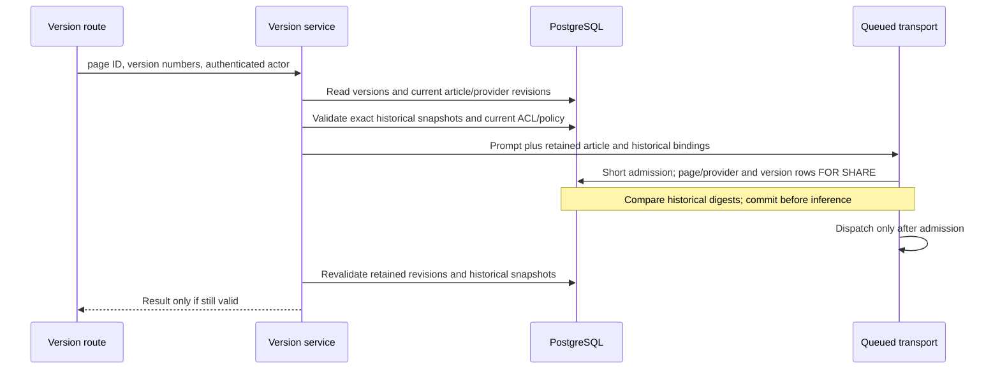

# Historical versions and article AI admission

Semantic diff is article processing, not a free-form query. The authenticated
route passes the actor to the version service. After lazy historical-body
fetch, the service retains the saved version IDs/numbers and SHA-256 digests
of the title/HTML/text tuples used to construct the prompt. Missing historical
bodies are unavailable, not certified empty input.

The digests remain internal admission data, not governance event metadata.
No title or body is added to decision evidence. Ordinary version reading and
restoration are not AI admissions and are unchanged.

The eval truncation probe uses the vendored fixture before article seeding and
is explicitly classified as synthetic evaluation. Seeded article embeddings
still use the ordinary article pipeline.

This correction is not rollout readiness. The mandatory transport cutover still
has failing backend/overlay regressions. The dimension probe in
`backend/scripts/run-retrieval-eval.ts` now explicitly identifies its synthetic
probe input as non-article traffic. Authoritative model selection still
uses a separate resolver checkout rather than the held admission transaction;
that race must be repaired before activation. Explicit semantic-diff model
choices also require compatible authoritative selection handling. Keep
restrictive activation closed. This mechanism cannot attest provider residency,
recall already dispatched bytes, or constrain manually pasted unrelated input.
