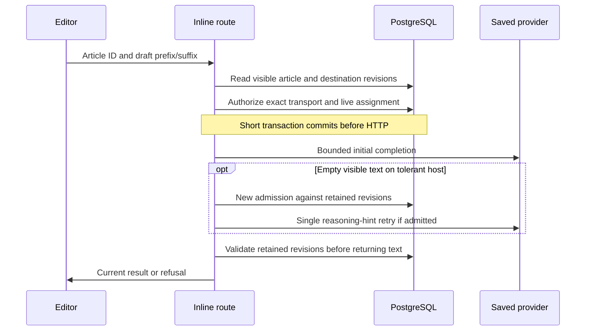

# Inline completion admission

Server inline completion requires an existing article identity. The route captures
server-read policy/content revisions through `directArticleTransport`; the bounded
inline HTTP client requires that retained article stage and authenticated actor.

Missing identity is refused, never converted to free-form inference. A refused
initial admission never sets the dispatched audit flag. Provider calls keep the
existing timeout, abort signal, FIM/chat capability selection and token limits.
A retry cannot swallow an article-stage refusal. Returned text is checked again
against article ACL, policy/content revisions, provider configuration and live
assignment; this does not recall bytes already sent before a restriction.

The browser completion manager uses the no-store POST
`/llm/inline-completion/browser-authorization`, which reuses
`requireGlobalPermission('llm:query')`, current page visibility and serialized
policy reads. Page-detail readability alone is never inference authorization.
The response binds the article ID and revision and contains no article bytes.
Both pre-worker and post-worker checks require explicit authorization. While
pending work or visible ghost text exists, Editor also checks on focus and every
second; refusal, unavailable policy or a revision mismatch clears only ambient
AI state. This is bounded polling, not instantaneous cross-browser revocation.

The browser completion manager now obtains uncached page policy immediately
before posting article bytes to its worker, then checks the policy revision again
before returning text. Missing identity, unknown policy and read failure cannot
start local completion or turn a rejected local result into server fallback.
PageView passes decoded live detail policy/revision and explicit content permission
to Editor. Changes to those fields, article identity or editability clear the
inline plugin in a layout effect, aborting its existing request signal (including
the manager's worker abort) without replacing the document or selection. Offline
events also clear ghost text. Missing detail/identity leaves ambient completion
disabled, including an unsaved new page. The final worker policy read is followed
by a cancellation check so an abort during that read cannot publish a result.
This is not hostile-client attestation. PageViewPage tests exercise the actual
Editor, extension and manager with only API and browser-worker boundaries
substituted: visible-ghost revocation, refused fresh local execution, pending
worker cancellation and draft/selection retention. The real EE/PostgreSQL HTTP
suite covers inline department override precedence, zero-dispatch accounting,
and restriction, assignment, endpoint and quota changes before a second send.
These bounded tests are not evidence of universal DLP or execution residency.
These changes do not enable rollout. Activation remains closed.
