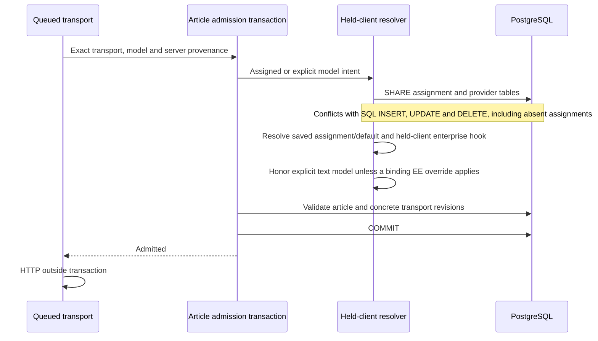

# Article-stage model selection

The CE dispatch resolver bypasses process caches and uses only the held
admission client. Table fences precede page/provider row locks and cover default
and assignment insertion/deletion as well as updates. They serialize with native
SQL writers, including writers that do not use advisory locks. Explicit model
intent cannot change the resolved provider. Existing text routes may choose a
model on that provider; saved assignments are defaults, not model allow-lists.
Vector and vision stages cannot use this text override. Non-inheriting stages
remain disabled when not assigned. An enterprise override, when present, pins the model as well as provider.

The new optional `resolveUsecaseOverrideOnClient` seam must read and fence EE
policy/department state on this same transaction. An installed legacy override
without that seam fails closed; it is never silently replaced by CE defaults.
The genuine overlay suite covers held-client policy and quota resolution,
including quota-writer fencing. Passing that suite does not establish that all
backend consumers have completed the mandatory transport-context migration.
Restrictive activation remains closed. The schema/API does not establish full
producer enforcement or universal data-loss prevention.
