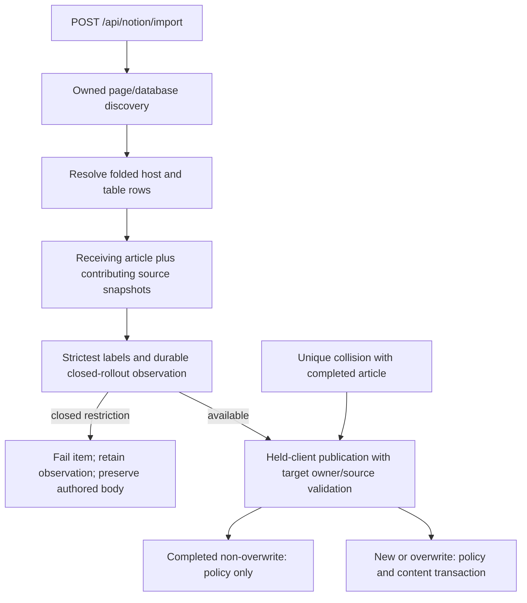

# Notion policy contributions

Notion import policy planning follows the article receiving the source bytes.
A folded database and its flattened table rows do not receive independent local
articles, but their labels still contribute to the receiving article's strictest
policy. Ordinary links do not establish this ownership. The existing discovered
`foldedInto` relation, not a label or a client-supplied local ID, selects the host.

Observation scope remains the importing owner and receiving Notion article ID.
For multiple contributions the observation revision is a digest of sorted source
identities, upstream revisions, and snapshot digests. No authored text is stored
in the observation metadata. A closed observation survives later upstream label
removal. Consumption and policy evidence commit atomically through the shared
publisher; failed evidence rolls both back. Consumed observations are not replayed
over a later authorized relaxation. A new restrictive upstream snapshot may
legitimately tighten again.

The concurrent-completion insert loser must publish policy before returning
`already_imported`. It rechecks the winner's live owner, source identity, visibility
and complete state on the held transaction. It does not overwrite the winner's
body or apply a creation default to that existing row.

`overlay/backend/src/enterprise/ai-policy-license-runtime.test.ts` drives the
public POST/status HTTP routes with real PostgreSQL, Redis and the genuine signed,
licensed EE plugin. Local upstream HTTP simulates Notion. It covers standalone
tables and folded tables, closed deferral, upstream removal, evidence rollback,
consumption, later relaxation, and a deterministic real-client insert race.
Production readiness remains default off. These tests do not establish the
separate full public Confluence journal-reconciliation matrix.
