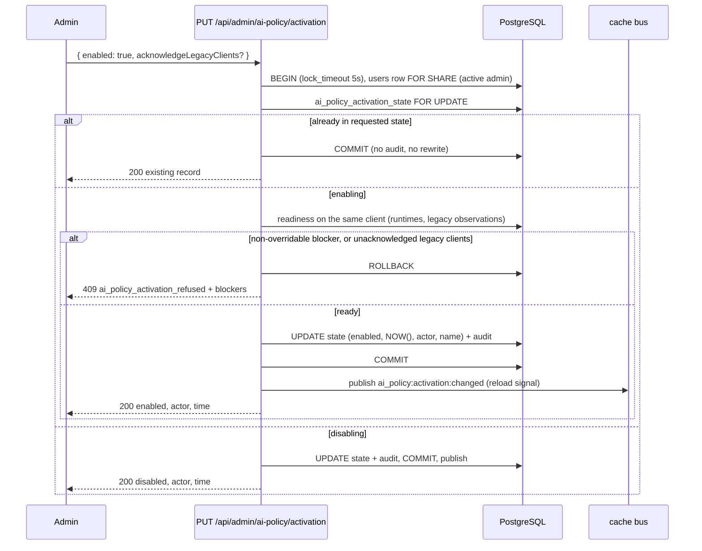
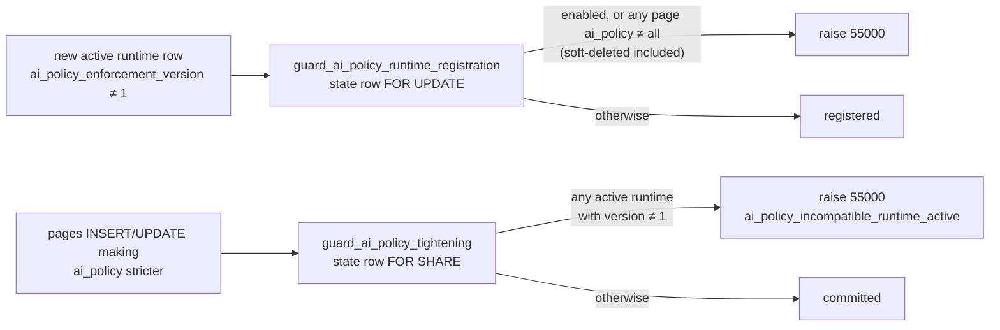

# Article AI policy activation

Restrictive article AI policies (`local_only`, `none`) can be chosen only
while the **enforcement switch** is on. The switch is Community Edition
property (#1881): one durable, cluster-wide row in PostgreSQL, turned on or
off by an active system administrator through
`PUT /api/admin/ai-policy/activation`, refused with named reasons while its
observable preconditions are unmet, and recorded with actor and time. No
licence opens or closes it; CE and EE behave identically, and a licence loss
never downgrades a deployment. The former EE env/licence hook
(`COMPENDIQ_AI_POLICY_ENFORCEMENT`, `aiPolicyEnforcementAvailable`) is gone;
there is no plugin activation hook to reintroduce.

What the switch governs is deliberately narrow: **new tightening**. Every
admission and dispatch path enforces stored restrictions whether the switch is
on or off. Turning it off therefore weakens nothing already stored; it closes
new restrictive writes (409 `ai_policy_enforcement_unavailable`, inert editor
copy, `aiPolicyActivation: 'foundation_only'` on page detail) and is the
emergency lever for the legacy-client refusal described below. While off,
editors cannot relax a stored restriction from the UI either (the API still
allows an authorised relaxation).

## Mechanism



- **Authority.** `requireAdmin`, then a `SELECT … FROM users … FOR SHARE`
  (active, `role = 'admin'`) inside the activation transaction so a
  concurrent demotion or deactivation serialises with it. Space admins,
  editors and page owners cannot activate. The route lives in
  `routes/foundation/ai-policy-activation.ts` under the admin rate limit.
- **Record.** `ai_policy_activation_state` carries `enabled`, `changed_at`,
  `changed_by_user_id` (SET NULL on user deletion) and the `changed_by_name`
  snapshot; each transition also writes an audit event
  (`AI_POLICY_ENFORCEMENT_ACTIVATED` / `AI_POLICY_ENFORCEMENT_DEACTIVATED`)
  with the blockers seen and, when used, the legacy-client acknowledgement
  with the observed users, count and window. State and audit commit in one
  transaction.
- **Idempotence and concurrency.** Transitions serialise on `FOR UPDATE`; a
  loser that finds the requested state returns the winner's record without a
  second audit row. The transaction sets `lock_timeout = '5s'`; a timeout
  answers a retryable 503 `ai_policy_activation_busy`. Disabling needs no
  preconditions.
- **Propagation (ADR-024).** `isAiPolicyEnforcementAvailable()` stays
  synchronous and reads a process cache
  (`core/services/ai-policy-activation.ts`) loaded from PostgreSQL at startup
  before routes and workers. If that first read fails the process starts
  *disabled* and keeps polling. The writing process reloads its own cache
  right after commit; other processes re-read on the
  `ai_policy:activation:changed` channel (payload ignored; it is a reload
  signal, never a state carrier), on bus reconnect, and by an unref'd 30 s
  poll. A stale *disabled* refuses new tightening (fail closed); a stale
  *enabled* after a switch-off can attempt a tightening for at most 30 s,
  which the tightening trigger refuses whenever an old runtime is active and
  which admission enforces in any case. No safety property depends on the
  cache, and no production path sets the cache without reading PostgreSQL.
- **Policy-aware clients** read `aiPolicyActivation` on every page-detail
  fetch; no reload is needed after a switch.

## Preconditions and refusal reasons

`GET /api/admin/ai-policy/activation` returns `{ enabled, changedAt,
changedBy, changedByName, legacyClientsAcknowledged, ready, blockers[] }`.
Enabling re-evaluates the same readiness under the row lock and answers 409
`{ error: 'ai_policy_activation_refused', blockers }` when a blocker stands.

| Blocker `code` | Observed how | Details | Overridable |
|---|---|---|---|
| `incompatible_ai_policy_runtime` | `page_writer_runtimes` rows with `fenced_at IS NULL AND quiesced_at IS NULL AND ai_policy_enforcement_version <> 1` (each backend process registers one row at startup; workers run in that process) | `total` + up to 50 `{ runtimeId, host, pid, startedAt }` | no |
| `legacy_clients_active` | rows in `ai_policy_legacy_client_observations` with `token_expires_at + 30 s throttle slack > NOW()` | `users` (distinct count), up to 20 `{ userId, username, lastSeenAt }`, `clearsAt` (= max expiry + slack) | yes, `acknowledgeLegacyClients: true` (audited) |
| `legacy_client_window_open` | the observer is blind to tokens issued before it existed or by old replicas: `NOW() < GREATEST(observing_since, MAX(quiesced_at) of version-0 runtimes) + access-token lifetime + 30 s` | `since`, `clearsAt` | yes, same acknowledgement |
| `ai_policy_enforcement_not_registered` | this process has not installed the readiness provider (installed at startup beside the baseline provider, before routes) | — | no |
| `ai_policy_readiness_unavailable` | the readiness read threw | — | no |

The acknowledgement belongs to one enabling transition: it is stored as
`legacy_clients_acknowledged`, reset by every disable, and required again on
the next enable. It overrides only the two legacy-client blockers.

Not observable and therefore operator duties (the same limit as the baseline
activation gate): processes that never registered a runtime row (pre-#275
builds), whether a version-0 row's process is really gone (fencing remains the
server-verified or owner-acknowledged procedure of the baseline runbook), and
browsers that send no `Sec-Fetch-Mode` (Safari < 16.4).

## The one-way door is on binaries

The switch is reversible. The spec's one-way door is enforced on **binaries**
by two database triggers (migration 151) that serialise in both orders, so no
policy-unaware build ever runs beside a restriction, independent of the
switch and of application code:



- **Registration** (`BEFORE INSERT OR UPDATE OF ai_policy_enforcement_version`
  on `page_writer_runtimes`): version 1 returns immediately without a lock, as
  does a re-registration of an existing `runtime_id` or a row that is already
  fenced/quiesced, so per-admission re-registration of current (and old)
  processes never contends. Only a genuinely new, active version-0 row takes
  `FOR UPDATE` on the state row and is refused if the switch is on or any
  page carries a restriction. A missing state row also refuses (fail closed).
- **Tightening** (`AFTER INSERT … WHEN (NEW.ai_policy <> 'all')` and `AFTER
  UPDATE … WHEN (NEW.ai_policy IS DISTINCT FROM OLD.ai_policy)` on `pages`, so
  it sees the value the BEFORE label trigger produced): when the new value is
  restrictive and stricter than before, it takes `FOR SHARE` on the state row
  and refuses if any active runtime has a version other than 1. Relaxations
  pass. This covers every writer — the policy primitive, creation INSERTs,
  recovery replay, deferred ingestion and a stale-enabled cache.
- Each trigger takes the lock and runs the existence check as separate
  statements. Registration first: the tightening's `FOR SHARE` waits, then
  sees the committed version-0 row and refuses. Tightening first: the
  registration's `FOR UPDATE` waits, then sees the committed restriction and
  refuses. Tightenings only share-lock, so they never block each other;
  enabling (`FOR UPDATE`) waits for in-flight tightenings.
- Partial indexes `pages (id) WHERE ai_policy <> 'all'` and
  `page_writer_runtimes (runtime_id) WHERE fenced_at IS NULL AND quiesced_at
  IS NULL AND ai_policy_enforcement_version <> 1` keep both checks index
  probes.
- The refusal (SQLSTATE `55000`, constraint
  `ai_policy_incompatible_runtime_active`, recognised by
  `core/services/ai-policy-runtime-guard.ts`) maps on HTTP paths to 409
  `ai_policy_enforcement_unavailable` with `reason:
  'incompatible_runtime_active'`. Recovery and deferred ingestion classify it
  as a refused tightening: the work stays pending and completes after the
  version-0 row is fenced; it is never terminal and never
  `intent_recovery_metadata_invalid`.
- **Rollback of binaries.** A pre-#1881 binary cannot register while the
  switch is on or any restriction exists, and no restriction can be created
  while one is active. Forward-fix only: never drop policy columns or
  reclassify rows to roll back to an ignoring build.

## Legacy-client marker

Browser bundles built before the policy-aware handshake cannot be stopped by
the server once loaded (the server never hears about their client-side
inference). The marker closes that gap as far as the server can:

- The SPA sends `X-Compendiq-Client-Protocol: 1` on every covered request
  through one helper (`withClientProtocol`): `apiFetch`, the raw refresh and
  logout fetches, the OIDC exchange and setup-admin. A frontend test
  enumerates every `fetch(` to `/api/auth/*` and `/api/setup/admin` and
  asserts the marker.
- Backend (`core/plugins/legacy-client-guard.ts`, registered globally before
  CE routes and before the EE plugin's routes, so EE's exchange route is
  covered without EE code) watches an explicit allow-list of session-issuing
  POSTs: `/api/auth/refresh`, `/api/auth/login`, `/api/auth/register`,
  `/api/auth/oidc/exchange` and `/api/setup/admin`. The GET
  `/api/auth/oidc/callback` navigation cannot carry a header and is not
  covered; the SPA's following exchange is. A request is *legacy* when it
  carries a browser-set `Sec-Fetch-Mode` and no marker ≥ 1. Non-browser
  clients (no `Sec-Fetch-*`) are unaffected.
- **Switch off:** the response is unchanged. Only a **successful** (2xx)
  session issuance by a legacy client records an observation: the `onSend`
  hook parses the serialised body for `user.id` and a detached upsert (errors
  logged, never failing or delaying the response) sets `last_seen_at`,
  `token_expires_at = NOW() + access-token lifetime` and increments
  `observations`, throttled per user and process to one write per 30 s.
  Forged unauthenticated requests record nothing; an authenticated griefer is
  attributed by name. Expired rows are swept by the existing token-cleanup
  job.
- **Switch on:** the request is refused in `onRequest`, before any credential
  check or token rotation, with 409 `{ error: 'client_reload_required' }`.
  The switch is read from the database on this rare path; a failed read
  answers 503 `ai_policy_unavailable` (fail closed). The legacy tab cannot
  obtain another access token; reloading loads the policy-aware bundle
  (`index.html` is never cached). The new bundle maps
  `client_reload_required` to a distinct "Reload this page to continue"
  message, never a generic login failure, so a header-stripping proxy is
  diagnosable. Refusing before rotation leaves EE's single-use OIDC login code
  unconsumed, so reloading the callback URL still signs in.
- CORS: `@fastify/cors` has no `allowedHeaders`, so requested headers are
  reflected; leave it unset.

**Cross-tab isolation.** The persisted auth state and the cross-tab
`BroadcastChannel` are named `compendiq-auth:p1` (versioned with the client
protocol). A pre-handshake tab still uses the unversioned `compendiq-auth`, so
it neither adopts tokens refreshed by up-to-date tabs nor signs them out when
its own refresh is refused and it clears its session. On first load the new
bundle copies the unversioned blob (user + `isAuthenticated`, never a token)
once and leaves it in place, so neither build's tabs are signed out by the
upgrade. Sign-in does not propagate between builds (each tab re-mints its own
token behind the shared auth-cookie lock). Session ends do, as far as each
build can tell them apart from a refused refresh:

- **Policy-aware → legacy:** every local session end in a policy-aware tab
  (explicit sign-out, or a refresh that resolved null; a refused refresh,
  409, rejects and keeps the session, so it never ends one) also posts
  `logout` on the unversioned channel and writes a logged-out unversioned
  blob; no token in either. A clear applied from another tab is not re-sent.
- **Legacy → policy-aware:** a change of the shared draft sign-out epoch —
  written only by an explicit sign-out, in builds 0.9.0 and later, never by a
  refused refresh — signs policy-aware tabs out. A legacy tab's other session
  ends (expiry, revocation) are indistinguishable from a refused refresh and
  are ignored.
- **Account switch:** if a policy-aware tab refreshes or adopts a token for a
  different account while still signed in (someone signed in through a tab it
  never heard sign out), `useClearCacheOnLogout` runs the #885 wipe and resets
  mounted queries so they refetch as the new account, and `ProtectedRoute`
  (keyed by user id) remounts the shell so its component state is discarded.
  The wipe runs inside the auth-store transition, before React renders the
  new account, so the remounted shell never reads the previous account's
  cache.

**Residual risk.** A legacy tab keeps the content it already loaded, and its
current access token, for at most one access-token lifetime
(`ACCESS_TOKEN_EXPIRY`, ≤ 24 h). The acknowledgement override accepts exactly
that bounded window and is recorded with the observed users in the audit
event.

## Failure handling

| Situation | Behaviour |
|---|---|
| Blocker present on enable | 409 `ai_policy_activation_refused` with the blocker list; nothing written |
| State row lock wait > 5 s | 503 `ai_policy_activation_busy`; retry |
| Bus publish fails after commit | logged; the response reports the committed state; other processes catch up on reconnect or the 30 s poll |
| First cache load fails at startup | process runs *disabled* (new tightening refused) and keeps polling |
| Tightening while a version-0 runtime is active | 409 `ai_policy_enforcement_unavailable` (`incompatible_runtime_active`); workers and recovery stay pending |
| Legacy client while on | 409 `client_reload_required` before any token rotation |
| Switch read fails on the legacy-client path | 503 `ai_policy_unavailable` |
| `COMPENDIQ_AI_POLICY_ENFORCEMENT` still set | reported once at startup as ignored; the switch alone decides |

## Operator procedure

1. Deploy the migration-151 build to every HTTP, collaboration, job, sync and
   maintenance process. Back up PostgreSQL first.
2. `GET /api/admin/ai-policy/activation` and read `blockers`.
3. **`incompatible_ai_policy_runtime`.** Retire every listed runtime through
   the baseline runbook (`docs/runbooks/immutable-page-baselines.md`, *Runtime
   retirement and fencing*). A live old process is drained with owner
   quiescence, fenced with its acknowledgement, **and then terminated**:
   quiescence closes page writes, not sign-in, so a quiesced process that
   keeps running keeps issuing sessions the legacy-client observer never
   sees. A dead process whose epoch has no started effects takes the
   server-verified `durable_no_started_effects` fence; that mode proves only
   "no started effects", **not** that the process is gone, so it is the
   operator's job to confirm termination first (prefer
   `verified_local_termination` where the server can check it). Every
   historical pre-#1881 runtime row needs this once, because older binaries
   never wrote `ai_policy_enforcement_version` and therefore sit at `0`. For
   many long-dead rows, fence an explicit list of runtime ids you have
   confirmed dead (for example, read from the blocker and checked against
   your orchestrator), stopping at the first refusal:

   ```sh
   # dead-runtimes.txt: one runtime id per line, each confirmed terminated.
   while read -r id; do
     status=$(curl -sS -o /tmp/fence.json -w '%{http_code}' -X POST \
       -H "Authorization: Bearer $TOKEN" -H 'Content-Type: application/json' \
       "$BASE/api/admin/page-write-recovery/runtimes/$id/fence" \
       -d '{"mode":"durable_no_started_effects","reason":"Historical pre-#1881 runtime; process confirmed terminated"}')
     # 409 runtime_effects_started, 429 or any other refusal: stop and
     # investigate (quiescence or a kind-specific reconciliation instead).
     [ "$status" -ge 200 ] && [ "$status" -lt 300 ] || { echo "$id: HTTP $status"; cat /tmp/fence.json; break; }
   done < dead-runtimes.txt
   ```

   The GET lists at most 50 runtimes per call with the `total`; re-read it
   after each batch. Fencing a long-dead row does not restart the
   legacy-client window; quiescing a live old process does (its `quiesced_at`
   feeds `legacy_client_window_open`), because that process may have issued
   tokens the observer never saw.
4. **`legacy_clients_active` / `legacy_client_window_open`.** Either wait
   until `clearsAt` or, in the UI, tick the acknowledgement and enable. On a
   fresh install `legacy_client_window_open` is expected for one token
   lifetime after migration 151 and acknowledging is appropriate: nobody
   could have held a pre-marker session. Old replicas killed *without*
   quiescence after migration 151 may have issued tokens the window cannot
   see; drain them through quiescence or wait one full lifetime before
   enabling without acknowledgement.
5. `PUT /api/admin/ai-policy/activation { "enabled": true }` (plus
   `"acknowledgeLegacyClients": true` when overriding). The response and the
   audit log record actor and time. Page detail now reports
   `aiPolicyActivation: 'active'`.
6. To turn off: `PUT … { "enabled": false }`. Stored restrictions stay
   enforced; only new tightening (and the UI's relaxation path) closes.

Settings → Governance → **Article AI policy** exposes the same state,
blockers, acknowledgement and both transitions.

### Upgrading from an env-flag deployment

Deployments that ran EE's `COMPENDIQ_AI_POLICY_ENFORCEMENT=enabled` come up
**disabled** after migration 151: their stored restrictions remain enforced
by admission, but new tightening is refused until an administrator enables
the switch. Remove the variable (it is ignored and logged once at startup).
Do not run a mixed fleet of env-flag and switch builds: an env-flag pod's own
tightenings fail at the tightening trigger with a 500 until it is replaced,
and its runtime row (version 0) blocks activation until it is retired.

### Licence semantics

None. Activation, readiness, the triggers and the legacy-client marker are
licence-independent and identical in CE and EE. EE's licensed features
(space creation defaults, cascade, evidence/report extensions) sit on top;
when a licence lapses, the switch stays as it was, stored restrictions stay
enforced, and only the licensed extras degrade (`resolveAiPolicyCreationDefault`
falls back to `all` for new rows).

## Trust limits

Locality is an administrator declaration, not residency attestation. A
committed restriction blocks new admissions, not bytes already sent.
Supported application paths cannot identify arbitrary manually pasted copies,
recall already-sent bytes, control upstream forwarding, or attest modified
clients. Fresh ingestion consumes deferred observations on the publishing
transaction; a durable evidence failure rolls back the article and
observation consumption. Applied observations must not be replayed after an
authorised relaxation. Bound Confluence journal recovery rechecks referenced
parents' policy mutation authority: matching content/lifecycle revisions alone
cannot detect role/ACE revocation.
