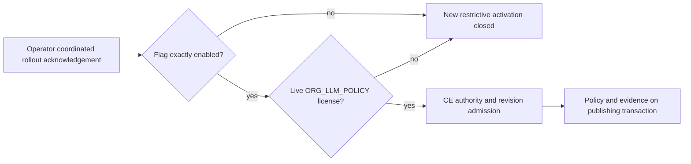

# Article AI policy activation

The EE plugin exposes the CE readiness hook through both its singleton and its
named exports. It returns true only when `COMPENDIQ_AI_POLICY_ENFORCEMENT` is
exactly `enabled` and the live license grants `ORG_LLM_POLICY`. Unset, `true`,
`ENABLED`, whitespace variants and an absent/expired license return false. Both
inputs are read on every call; CE's no-op remains closed.

Setting this flag is the **coordinated rollout step**, not schema installation or
proof of enforcement coverage. It is off by default. Keep it unset until all
worker and interactive enforcement slices are deployed, old replicas/workers
are drained, stale clients are forced through the policy-aware handshake, and
the deployment's admission/finalization and replay matrices have passed. The
current foundation review still has outstanding transport/evidence cutovers;
this hook does not certify those as complete.

To close new activation, unset the flag on every backend/worker and restart
processes whose environment is immutable. License loss also closes activation.
Neither action relaxes stored policies or disables CE dispatch enforcement.
Once any restriction exists, do not roll back to policy-unaware binaries, drop
columns, or reclassify articles: retain enforcement, pause AI, or forward-fix.

Fresh ingestion consumes deferred observations on the publishing transaction;
a durable evidence failure rolls back the article and observation consumption.
Applied observations must not be replayed after an authorized relaxation.
Bound Confluence journal recovery rechecks referenced parents' policy mutation
authority: matching content/lifecycle revisions alone cannot detect role/ACE
revocation.

Locality is an administrator declaration, not residency attestation. Supported
application paths cannot identify arbitrary manually pasted copies, recall
already-sent bytes, control upstream forwarding, or attest modified clients.
