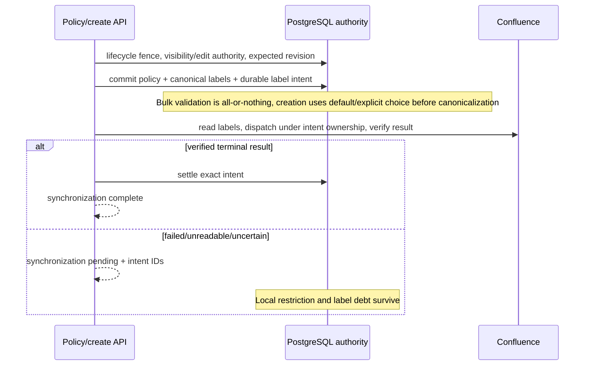

# Article policy label write-back

Confluence-off commits locally with zero upstream calls and no new remote debt.
Dedicated single/bulk policy writes reserve debt in the policy transaction;
interactive Confluence creation reserves it in the publication transaction.
Recovered creation also reserves the obligation. The CE core helper depends on
no domain service; the route and Confluence reconciler own remote I/O.

Only a revision-guarded authorized new policy command may replace provably
undispatched policy-label debt. A stale or unauthorized command rolls back both
retirement and replacement. Started unversioned writes with unknown outcomes
remain unresolved; they are never blindly replayed. After the original runtime
is safely fenced, recovery may perform a first dispatch of no-start debt under
fresh authority and exact policy/content/lifecycle revision checks. Recovery
verifies labels without reapplying the historical policy. Generated-label
compensation retains sole ownership during policy supersession.

Creation validates the original incoming labels before inserting a canonical
label: ordinary labels do not manufacture an explicit `all` command. An
explicit authorized restrictive choice and unrelated labels are compatible;
real contradictory reserved labels remain a 422.

This is bounded application governance, not universal DLP, endpoint attestation,
verified residency or zero-egress proof. It cannot recall already-dispatched
bytes, identify unrelated pasted copies, or control modified clients/proxies.
Schema installation alone does not activate enforcement. Drain old workers and
backends and require policy-aware browser handshakes before coordinated rollout;
once restrictions exist, retain enforcement, pause AI, or forward-fix rather
than rolling back to a build that ignores policy.
