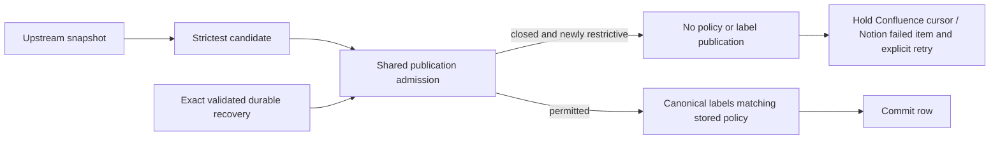
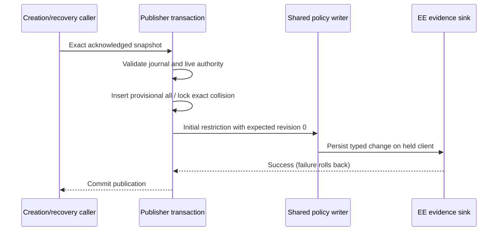
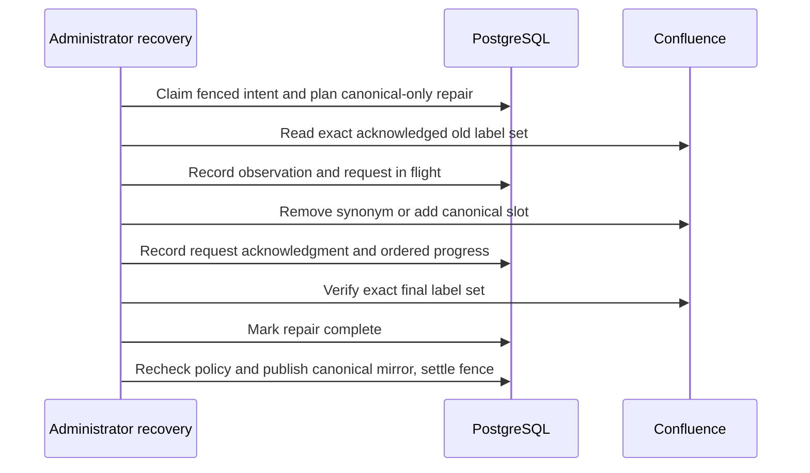

# Article AI policy: recovery admission is not activation

Restrictive activation remains closed. Installing policy columns or journal constraints does not enable universal enforcement.

## Bound Confluence creation journals

`admitFreshConfluencePublication` distinguishes a conservative **fence** from durable **authorization**:

- An unbound creation with missing or unreadable policy metadata is fenced as the strictest policy. This prevents weaker publication; it does not grant permission to publish a restrictive page.
- A receipt bound to the incoming Confluence ID must also have decodable, explicit initial policy metadata. Contradictory journal labels defer publication with `unbound_create`; the fallback from `fencePolicyOfEffect` cannot authorize recovery.
- Recovery additionally requires the server-fetched version, space, parent, title digest and storage digest to match the journal, with a live creator and current referenced revisions.
- A valid recovered statement cannot authorize a stricter new upstream policy while enforcement is unavailable.

The sync first-publication integration suite uses real PostgreSQL and stubs only the Confluence boundary. Its contradictory-label regression checks that no attachment fetch occurs and no page is inserted. Existing positive recovery and snapshot-substitution controls remain in that suite.

## Automatic ingestion publication

`resolveIngestionAiPolicy` remains a candidate planner, never publication authority. `admitAutomaticIngestionPolicy` is the shared publication check for Confluence fresh recovery, existing-row upsert, conflict updates, and Notion creation/re-import. The unguarded SQL tighten helper has been removed. Existing rows are read under the publication transaction's row lock; a fresh upsert racing another insertion defers rather than adopting or overwriting the unadmitted row.

A closed-rollout deferral preserves the entire local row rather than silently accepting the body with a policy of all. Existing restrictions never relax. Confluence counts deferrals separately and holds the space cursor so the upstream window is retried at activation; Notion reports the item as failed (including the readiness reason), leaving the source available for an explicit re-import. No upstream label write-back erases restriction intent. This is source-backed retry, not a durable archive of upstream snapshots: operators must retain the source until reconciliation. Canonical normalization preserves unrelated labels. The fresh journal exception still requires the exact validated identity, snapshot and policy; unreadable metadata only fences, never authorizes.

## Acknowledged creation publisher

`publishCreatedConfluencePage` inserts a provisional `all` row with canonical
ordinary labels on the held transaction, then applies the admitted restriction
through `applyAiPolicyOnClient`. The row is not externally visible between
these statements. Policy revision, purge and typed evidence commit together;
an evidence insert failure rolls the new row back. Exact sync-first collisions
may take the initial policy only at policy revision zero. Any later policy
revision, including an authorized relaxation, wins over the old creation
statement. Recovery rechecks referenced parents' policy authority.

The licensed PostgreSQL regression covers fresh/collision publication, evidence
failure rollback, idempotent retry, and retry after relaxation. This helper
proof does not replace the complete native HTTP/import and journal-recovery
matrix required before activation.

## Legacy ordinary label canonicalization

Migration 143 adds `page_label_canonical_repairs`, separate from the immutable
ordinary intent and its original terminal response. Recovery first claims the
fenced writer under live administrator authority. Only acknowledged ordinary
label kinds can enter this capability; generated compensation remains separate.
The shared planner derives a canonical slot from current policy. Any policy
move is refused, and unrelated labels must be identical. Current actor access,
space access, policy revision, lifecycle/content revisions and pending intent
ownership are checked before every journal checkpoint.

Remote mutations run without a held database connection. Each acknowledged
request has durable progress; a lost response retains `in_flight` and blocks
retry rather than guessing. Independent upstream changes conflict. The original
request and terminal evidence are not rewritten to claim they already contained
the canonical slot. Completed repair evidence is accepted only at the same
policy revision. Real PostgreSQL tests cover absent slots and synonyms for all
three stored policies, one free connection, immutable original evidence,
unknown outcomes, independent remote edits, preserved policy/body, fresh writes
after settlement, and administrator HTTP recovery with live-role revocation.
This is not general remote replay and does not activate restrictive policy.

## Remaining rollout blockers

Optional article context at provider transport and incomplete final publication/evidence coverage remain blockers. Neither this correction nor passing regression gates is grounds to enable restrictive rollout. Activation-time reconciliation must use current authoritative rows and tighten-only admission after the coordinated rollout, not replay an unchecked planner result.
