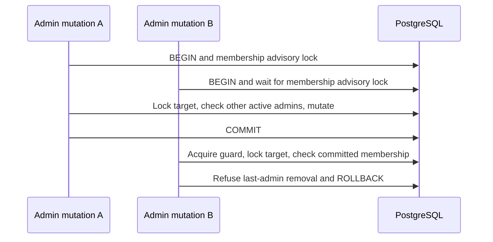

# Review boundary corrections

## Final receiving-stage refusal evidence

`admitArticleStage` retains the error classification in its typed blocked event:

- A current policy denial records `ai_policy_denied`.
- Unreadable provider/article authority, checkout failure, or SQL failure records
  `policy_unavailable`, not a claim that authoritative grounding changed.
- A readable but changed binding records `grounding_changed`.

The metadata snapshot remains best-effort and keeps unknown values unknown.
Publication is still not another inference attempt. No inference runs inside
these transactions, and refusal produces no completed-inference usage row.

## Administrator membership serialization

The backend regression gate exposed a lock-order cycle between cross-admin
mutations. `deactivated_by` references the actor row: taking a target row lock
before the membership guard could leave the guard holder waiting on the actor
row owned by its guard waiter. Every update/deactivate/delete transaction now
takes the membership advisory lock before locking its target. Last-admin checks,
mutation and session revocation remain in the same transaction.

The deterministic PostgreSQL regression holds the membership guard and checks
that each blocked mutation leaves its target row available to `FOR UPDATE
NOWAIT`. The existing simultaneous cross-admin regression continues to require
one success and one `LAST_ADMIN`, never a raw deadlock exception.
