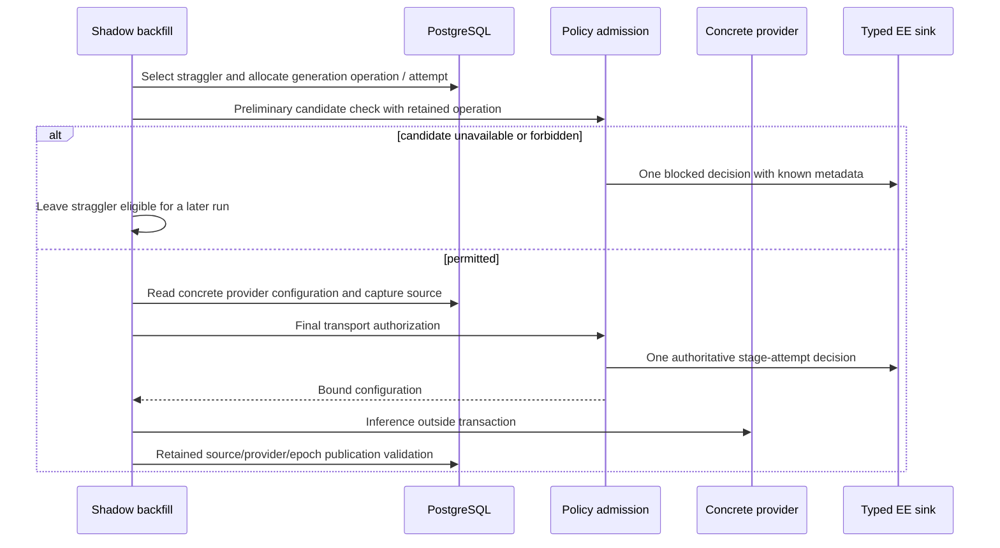

# Shadow and explicit embedding decision identity

CE migration 148 separates evidence scheduling from the page row. It does not
change page xmin, content, policy, or publication authority. Production activation
remains default OFF; this migration is not rollout authorization.

`shadow_embedding_ai_operations` keeps one operation per page, migration epoch,
content revision and image revision. Separate job runs and later batches increment
attempts atomically. Epoch/generation replacement starts a new operation. Provider
absence does not skip the selected set: each straggler receives its own typed
refusal. Configuration read failure after preliminary permission also refuses;
preliminary allowed checks never count as admitted inference.

Explicit `embedPage` callers retain actor/source/operation identity. Their attempt
counter is now `explicit_embedding_ai_attempts`, keyed by page and operation UUID,
not JavaScript object identity. Allocation precedes explicit source capture: two
stale-input refusals consume attempts 1/2 and a later permitted dispatch consumes
3, retaining caller identity. Reconstructed contexts and separate processes
therefore cannot restart numbering. Shadow source-capture failure has its own
narrow pre-transport refusal boundary, retaining the allocated operation/attempt
and known destination identity while rereading current metadata. It does not catch
final transport or publication refusals, so it cannot duplicate their decisions.
The genuine EE fixture exercises a real source update between reads, zero HTTP
on that refusal, persisted metadata and report readback for both boundaries.
Migration 149 removes the explicit counter's page foreign key: hard deletion must
not erase numbering or prevent numbering the refusal of an already-missing page.
Only identifiers and counters survive, never article content or permission.
Shadow generation selection still cascades on deletion, but its attempts use the
independent counter too. Later batches retain the original operation rather than
selecting a successor generation. A changed source reaches final transport
validation, records one blocked attempt and sends no second HTTP request. The
real PostgreSQL/HTTP counter regression exercises 17 chunks with an image-revision
change during the first response and checks attempts 1 admitted / 2 blocked,
unique event IDs, and zero published shadow vectors. An active
shadow dual-write target that cannot resolve yields a typed unavailable refusal
while the independently permitted live stage can complete.

Verification: `embedding-stage-operation.db.test.ts` exercises idempotent migration,
concurrent allocation, epoch/image replacement, source-xmin preservation and actual
shadow HTTP failure/retry. The genuine licensed EE first-publication fixture proves
vanished candidate / failed HTTP / recovered shadow attempts 1/2/3 under one
operation, distinct event IDs, exactly two HTTP calls and three report rows. It
also exercises reconstructed explicit contexts and unresolved dual-write. Existing
shadow publication races still validate policy, content, provider, model, candidate,
image, claim, epoch and later-batch changes. No prompt, body or URL enters these
events. These records are bounded application evidence, never execution attestation.
