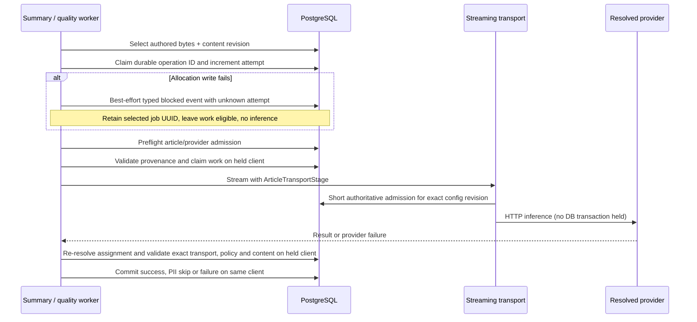

# Summary and quality publication

Restrictive activation remains closed. This consumer cutover is not a rollout
certificate and does not close the embedding, auto-tagging or legacy-evidence gaps.

The candidate content revision travels with the bytes, not a later reread.
A changed policy, content revision or provider configuration rejects publication
of both successful and failed inference. A refusal does not consume the article's
provider retry budget. Early policy denial uses `publishCurrentAiPolicyBlock` to
recheck the current denial under locks rather than parking work from a stale
preflight. Success webhooks are emitted only after committed publication.

`streamChat` currently bypasses the ordinary non-streaming queue; its stage
check executes immediately before the breaker/HTTP dispatch. No queue, model,
token ceiling or timeout behavior is changed here. Queued non-streaming calls
must independently use their after-wait authorization hook.

The HTTP/real-PostgreSQL/Redis tests in
`routes/knowledge/summary-policy-publication.db.test.ts` cover allowed completion,
policy tightening, content revision change, endpoint change, and failed inference
following content change for both workers. The legacy image worker suite now
intercepts outbound HTTP instead of substituting `analyzeImage`; real admission,
queue, breaker and response classification therefore run in those scenarios.

These tests are not public policy-transition/activation proofs. Other consumer
cutovers, mandatory transport context, full refusal serialization, lifecycle/lease
successor coverage and typed legacy decision-evidence replacement remain separate
review obligations. Already-sent bytes cannot be recalled.

Migration 144 stores the summary operation UUID and attempt on the page. Each
bounded candidate claims its next attempt with a content-revision guard before
preflight. Failed/interrupted retries keep that identity across batch runs;
content changes, completed-generation requeues and explicit rescans reset it.
Missing summary configuration emits one typed refusal per selected candidate,
keeps work eligible, and does not bulk-rewrite statuses. The genuine EE HTTP
fixture reads back failure/retry and unresolved/recovery decisions from the real
writer, with attempts 1/2 and a stable operation; it also checks report readback.
The public summary route allocates context before resolving its provider and
records an unresolved destination without publishing draft text or endpoint URLs.

Migration 145 gives quality its own durable operation UUID and attempt counter.
The batch claims a content-revision-bound attempt before preflight; unresolved
assignments emit a typed refusal with null provider metadata and keep pending
work eligible. Failure/recovery retains identity, while new content and explicit
rescans reset it. Quality's independent genuine EE HTTP scenario verifies two
admitted retry decisions, unresolved/recovery decisions, and report readback.
Publication remains revision-guarded and does not emit extra inference counts.
The selected summary/quality operation UUID is retained before its claim write.
A failed claim emits `policy_unavailable` with `attempt: null`, never a guessed
ordinal; a zero-row successor race remains silent. Image active and paused paths
share the same guarded claim rule and retain the selected image operation UUID.
The genuine EE fixture installs PostgreSQL rejection triggers on attempt writes,
checks repeated refusals, distinct event IDs, unchanged work/usage and zero HTTP,
reads unknown ordinals from the real report, then removes the trigger and proves
recovery at the next committed ordinal. If no UUID has yet been committed, the
allocation request has a fresh identity; an unavailable historical identity is
not reconstructed. Evidence persistence remains best-effort during total outages.
The public quality route also records unresolved provider refusal and revalidates
cached output after waiting without counting cache reuse as inference. Public
inline completion retains request context before resolution and records an
unassigned refusal despite its established empty-success response.
These proofs do not certify every producer in the epic or enable activation.
