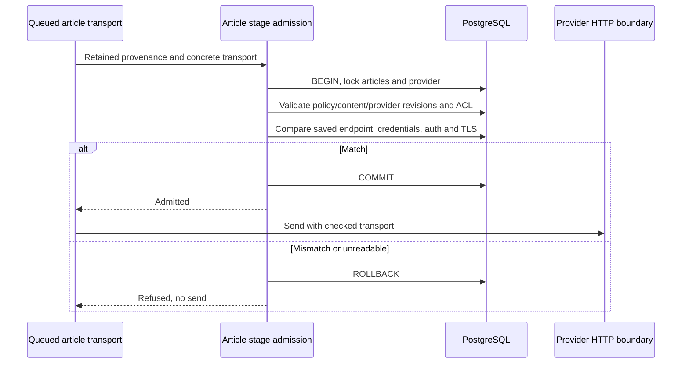

# Concrete article transport binding

The article-stage admission transaction checks the saved provider configuration,
not only the provider ID and revision asserted by a caller. While holding the
provider row's shared lock it compares the outgoing base URL, decrypted API key,
authentication mode and TLS verification setting with the saved row. A missing
row, mismatch or credential decryption failure refuses dispatch. Credentials are
never included in governance events.

`article-transport-binding.db.test.ts` uses real PostgreSQL and an outbound HTTP
mock to substitute each concrete transport field while retaining valid IDs and
revisions. It proves zero sends for substitutions and one send for the saved
configuration. Existing queue/provider-edit and stale-publication tests remain
applicable.

This correction does **not** complete the transport cutover: transport context is
still optional in the OpenAI-compatible entrypoints, model selection is not bound
by this comparison, and legacy admission/evidence consumers remain. Activation
must remain closed. Admission ends before network inference, bytes sent before a
later policy commit cannot be recalled.
