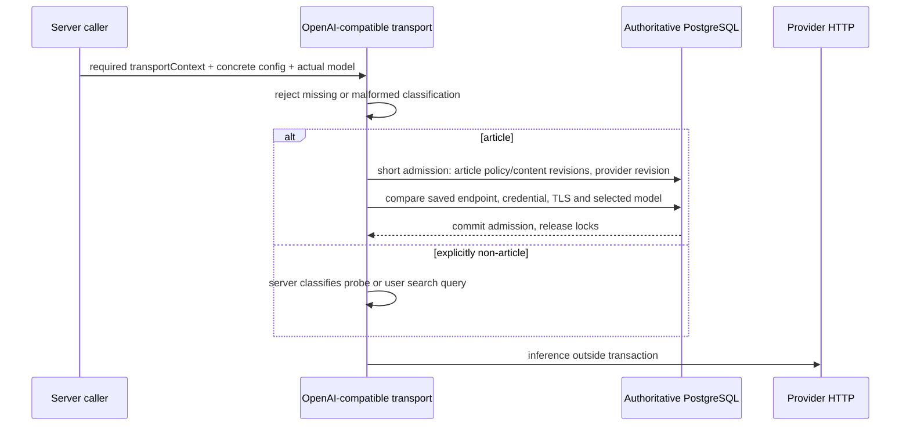

# Mandatory transport context cutover (incomplete candidate)

Production restrictive activation remains CLOSED. This candidate is not integration-ready.

Chat, completion, stream, embeddings and image analysis no longer have an
optional authorization fallback. Existing worker article stages are wrapped in
an explicit article context. Query-only embeddings/reformulation and fixed
provider probes use an explicit non-article classification. The classification
is a server API, not a field accepted from HTTP clients.

Article dispatch compares the actual model argument against the current use-case
resolver (including EE overrides), or the saved active shadow target for shadow
embeddings. Saved endpoint/authentication/TLS comparisons remain in place.
Model assignment resolution currently uses a separate resolver checkout; it is
not yet an atomic assignment-epoch lock with the admission transaction.

PII judge output is potentially article-derived. A pageId alone does not certify
its transitive grounding. The judge now accepts retained provenance and refuses
legacy jobs without it; it does not relabel unknown output as a user query.
Existing enqueue producers still need to supply complete server provenance.

## Remaining mandatory caller migrations

The merged production compiler identifies exactly these ungranted files:

- `ce/backend/src/domains/knowledge/services/version-tracker.ts:369`: historical
  article version comparison; needs complete authorized historical grounding,
  not a non-article classification.
- `ce/backend/src/domains/llm/eval/seed.ts:231-232`: two embedding calls; compiler
  discovery only (file is outside this attempt's read/write roots).

No compatibility overload or silent fallback was added to hide those errors.
All merged gates build first, so these errors prevent execution of the new
HTTP-boundary binding tests and the existing regression suites.

Direct article action migration is conservative and incomplete: missing page
identity and sub-page requests without a complete source set refuse; ordinary
single-page requests capture policy/content provenance. This is not proof of
full draft/sub-page/cache compatibility. Generation's existing free-form
surface and all public action identity callers need a complete #282 audit.

The test `article-transport-binding.db.test.ts` checks missing/malformed contexts,
endpoint/auth/TLS/model substitution, a successful saved binding and stale
content. It is authored but not executed in this attempt because the build
fails at the two ungranted callers. Queue-time matrices remain required.

These application controls cannot attest residency, identify unrelated manually
pasted copies, recall bytes already sent, or control operator proxies or modified
clients. Do not enable activation on the strength of this partial cutover.
