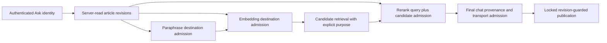

# Interactive query provenance and admission

Article-bound Ask carries the server-read open article's policy/content revisions
separately from the retrieval candidate purpose. Query embedding and paraphrasing
bind those dependencies to their own resolved provider. Paraphrase retrieval legs
inherit the same dependencies. Reranking admits the union of query dependencies
and candidate dependencies, so local chat never licenses an external secondary
stage. Denied optional stages retain the deterministic fusion ordering and do
not fabricate rerank scores. The existing queue/transport admission checks the
concrete destination again immediately before HTTP.

Generate's independent-input cache records an explicitly empty versioned page
set bound to the actual provider configuration revision and declared locality.
Missing legacy provenance is unknown, not empty. Replay compares the recorded
binding and re-admits it before sending cached bytes; failed invalidation cannot
make an old endpoint binding reusable. No inference is performed on a replay.

Conversation titles retain the question fallback when provenance cannot be
admitted. Preflight and beforeDispatch checks are preliminary, sharing the
operation identity with actual transport admission. They do not emit extra
admitted decisions; final publication remains revision guarded.

This is supported-application enforcement, not DLP or execution attestation:
arbitrary manually pasted copies cannot be recognized as article content,
operator forwarding is not independently verified, and bytes already dispatched
or streamed cannot be recalled. Generate's remaining page-identity contract and
the separately owned frontend integration are not solved by cache provenance.
