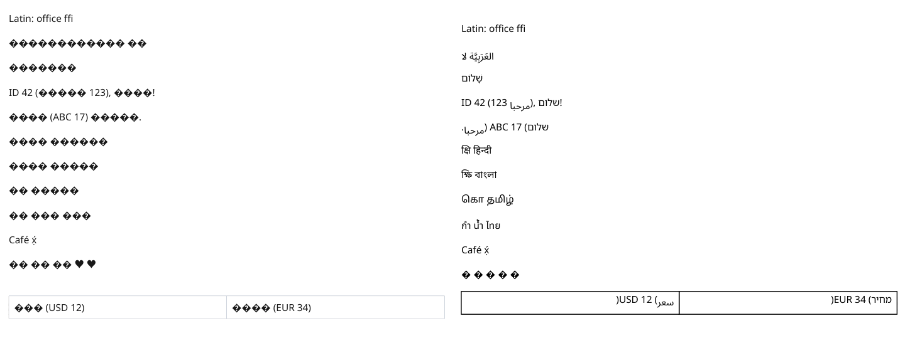

# ADR-028 measurement appendix — what was printed and what was copied

[Decision and acceptance gate](../ARCHITECTURE-DECISIONS.md#adr-028-complex-text-in-pdf-exports). Synthetic documents only. No candidate code or font ships with this record.

## Fixed corpus and oracle

Save this UTF-8 block as `corpus.cjs`. Do not replace the escaped NFD input with a visually similar composed string. `lines`, then `cells` in source order, are also the **expected logical extraction**, allowing NFC and layout whitespace but no reordering, lost selectors, inserted controls or missing words. For the incumbent, loss for unsupported visible scalars is expected and recorded separately.

```js
const lines = ['Latin: office ffi', 'العَرَبِيَّة لا', 'שָׁלוֹם', 'ID 42 (مرحبا 123), שלום!', 'שלום (ABC 17) مرحبا.', 'क्षि हिन्दी', 'ক্ষি বাংলা', 'கொ தமிழ்', 'กำ น้ำ ไทย', 'Cafe\u0301 x\u0323\u0301', '👩‍💻 👍🏽 🇩🇪 ♥︎ ♥️'];
const cells = ['سعر (USD 12)', 'מחיר (EUR 34)'];
const block = lines.map(s=>`<p>${s}</p>`).join('')+`<table><tr>${cells.map(s=>`<td dir="rtl">${s}</td>`).join('')}</tr></table>`;
const html = { typical:block, long:block.repeat(32), near:`<pre>${'a\n'.repeat(1000)}</pre>`, refuse:`<pre>${'a\n'.repeat(2500000)}</pre>` };
module.exports = {lines,cells,html};
```

| Input | HTML bytes | SHA-256 of HTML, no trailing newline |
|---|---:|---|
| Typical, eleven paragraphs and two RTL cells | 455 | `6cde6d61e4aa2f6a4eceab902d9999bd12005174eb46fe342fce56bb4d4c25c9` |
| Long mixed-script article, same block 32 times | 14,560 | `b1151f47fc250d8a615050551a17a1fe9cc7c299a0ddb9afdad93e2ff6f0acf8` |
| Accepted at the printed-row limit | 2,011 | `3e33ae560e99c169aaa0ca9c52d86fe38f078732d5f2357819f37cef13befe92` |
| Rejected, 5,000,000 bytes of short lines inside `pre` | 5,000,011 | `6a9f8f32dbc7a9298887f489ef3a1ba36b2514253ad6896a640768499d2ce76a` |

## Rendered page and independent text readers



MuPDF 1.28.2, same point rectangle `(40,35,554,420)` and 1.4× matrix on each saved PDF. The right column has joined Arabic, Hebrew points, pre-base Indic vowels, Thai marks and a right-edge alignment in both cells. **The parentheses in the right-hand table are visibly wrong.** The left column has replacement diamonds throughout those scripts; on the emoji row the last two selectors disappear and both heart bases print. The right column intentionally uses one diamond per unsupported emoji cluster in this experiment. The NFD line looks similar at this scale; that is not proof the offsets match. The long input paginated to 16 pages in both; the last page still had both currency cells. These are observations, not a native-speaker review or a general typography pass.

| Probe | Actual result |
|---|---|
| Incumbent, `unpdf` 1.6.2 (PDF.js) | `Latin: office ffi` and `Café x̣́` survive. The mixed line is `ID 42 (����� 123), ����!`. Both amounts remain but not their Hebrew/Arabic labels. MuPDF plain-text extraction omits many diamonds even though the raster shows them. |
| PDFKit, same PDF.js | `ID 42 (123 مرحب ا), שלום!` instead of the source mixed line. `क्षि` copies as `िक्ष`; Tamil `கொ` as `ெகா`; Thai `กำ` as `กํา` (not NFC-equivalent). Cell one gives `)USD 12 (سعر`. Hebrew mark order needs canonical comparison; do not use scalar-count-only checks. The Arabic word contained embedded U+0003/U+0007 in extraction. |
| PDFKit, MuPDF | `/ActualText` on an entire line does not repair this file for both readers: plain text included `क्षि हिन्दीन्दी`, duplicated Tamil and NFD fragments, and only `)` for each cell. A UAX #9 visual-order string is not suitable ToUnicode data. |
| HarfBuzz, original unstripped outlines | `ffi` → source GID 1656; `கொ` → 46, 18, 41 at cluster 0; `क्षि` → 551, 90 at cluster 0. `x` + dot below + acute → GIDs 91, 2696, 2665; mark advances zero, x offsets +34 and +6. First Arabic mark in `العَرَبِيَّة` had offset (+101,+65). Drawing unpositioned advances omits real geometry. |
| pdf-lib public API on those outlines | `embedFont(bytes,{subset:true}).encodeText('ffi')` returned `<0001>`; the NFD probe encoded `<000100020003>`, not the source GIDs. `drawText` produced searchable `ffi` but the drawn Arabic extracted with control bytes. The installed `@pdf-lib/fontkit` also threw `regeneratorRuntime is not defined` when asked to lay out the unstripped Tamil font in that Node process. The adapter is ruled out by its writer contract, **not** by this incidental runtime error. |

## Cost on the guarded build

Apple M5, 24 GB host; Docker 29.9.2 native linux/arm64, Node 24.22.3, Alpine 3.24.4, ICU 78.3. Same production backend build from `fba9be4b2c7ba2bb2b775b820fed086cd4c5e96d` (#1962, before #1970). `docker image inspect .Size` is Docker's reported local image size, **not transfer bytes**. Baseline: 657,227,596 bytes, six font files plus licences 18,071,224 bytes (the documented 18.1 MB / ~17 MiB). #1970's separate delta is not attributed to a shaping engine. The incumbent adds zero bytes. PDFKit added **10,815,910 bytes of dependency files**, **945,832 bytes of TTFs + 30,690 bytes of notices**, and **15,878,870 actual image bytes** (673,106,466 total), as separate `COPY node_modules` / `COPY fonts` layers. No emoji asset in that image. For comparison the sandbox-rejected Chromium image measured 1,869,043,952 bytes, including transitive APKs. It never rendered a page; no browser-only RSS/time is presented as a process-tree measurement. A custom HB text writer was eliminated before a runtime image (see ADR); no invented timing or size estimate for it.

One discarded warm-up process, ten fresh Node processes per candidate/input, shared kernel page cache, one export per process. No concurrent requests; two CPUs, 1 GiB memory/no extra swap, 560 MiB effective V8 heap (`--max-old-space-size=512 --max-semi-space-size=16`), no network, root FS read-only, no capabilities or credentials. Time from entry with modules already imported and HTML constructed, through save or typed refusal; excludes process launch, output file I/O and HTTP. RSS = maximum Linux `process.resourceUsage().maxRSS` (KiB) across the ten processes, including imports. No child render processes in either measured writer. Percentiles = nearest-rank (5th/10th of ten). Small-sample p95 is the maximum, not a capacity guarantee.

| Writer / input | p50 ms | p95 ms | Peak KiB | Result (PDF bytes / pages) |
|---|---:|---:|---:|---|
| Incumbent / typical | 198.81 | 361.73 | 218,336 | 7,520–7,522 / 1 |
| PDFKit / typical | 345.69 | 557.57 | 182,916 | 18,681 / 1 |
| Incumbent / long | 173.18 | 249.44 | 217,000 | 25,946–25,948 / 16 |
| PDFKit / long | 468.43 | 518.73 | 187,584 | 51,425 / 16 |
| Incumbent / near | 190.00 | 205.96 | 186,340 | 29,397 / 20 |
| PDFKit / near | 64.21 | 114.65 | 166,424 | 15,652 / 23 |
| Incumbent / refuse | 1,589.78 | 1,802.02 | 330,444 | 413 / no bytes |
| PDFKit process / refuse | 1,412.13 | 1,609.45 | 340,388 | same #1962 admission, 413 / no bytes |

The 5 MB numbers are **time/cost to reject, not time to render**. Both series called the same guarded implementation; the difference is not a speedup in a second guard. Never send this fixture to a pre-#1962 writer. The near case distinguishes actual rendering from admission. The prototype uses a simple A4 layout, not production borders, footer or pagination parity. No extrapolation to complex tables, shaped near-cap alternating-font rows, concurrent exports or browser memory. Host load varied; in particular do not infer that long input is cheaper than typical input on the incumbent.

Raw elapsed ms, in trial order after warm-up:

```text
base typical  169.63 181.73 184.19 267.30 293.09 236.23 198.81 196.80 281.49 361.73
kit  typical  306.54 299.88 345.69 267.64 355.65 397.72 538.98 557.57 414.32 208.89
base long     173.18 155.99 213.16 167.76 184.24 166.96 249.44 212.08 150.88 182.05
kit  long     453.27 449.45 513.00 472.84 518.73 503.76 454.08 456.16 468.43 475.40
base near     187.19 190.00 169.16 194.73 182.52 204.69 204.70 205.96 142.33 199.60
kit  near     114.65  70.85  64.21  62.49  58.03  68.41  57.04  58.69  65.95  67.39
base refuse 1654.04 1478.13 1622.93 1438.00 1802.02 1740.15 1508.34 1589.78 1493.53 1776.13
kit  refuse 1532.91 1352.53 1234.09 1323.29 1609.45 1551.81 1578.11 1412.13 1233.22 1435.94
```

## Assets, licences and emoji experiment

Shaping inputs are unchanged upstream `fonts/<family>/unhinted/ttf/<family>-Regular.ttf` at [notofonts/notofonts.github.io@4cf78353](https://github.com/notofonts/notofonts.github.io/tree/4cf78353cd1668040ba8efa13029cd910fcdf9e2/fonts). One regular weight per family; no claim for bold/italic. All SIL OFL 1.1. For each family keep its own copyright and complete `ofl/<lowercase family>/OFL.txt` at [google/fonts@06bfe0d6](https://github.com/google/fonts/tree/06bfe0d62a98375cb09c942fa18e68bd32cff057/ofl). Do not strip the layout tables on these experimental faces or replace prepared fonts in the incumbent.

| Noto family | TTF bytes | SHA-256 |
|---|---:|---|
| Sans | 431364 | `f3961a9cde016d41a4879aecda1474d3a36d6bf54fa0e4643de029cc2248b0e8` |
| Sans Arabic | 142140 | `bd86ca02f087d7f3c3788ba458fb6b73744c7639ed276b8d870dba6def6c40d0` |
| Sans Hebrew | 16836 | `04272f5600d0ec816d31d0df73b23aa8d3501ea359ebe820da31c11ffcf00853` |
| Sans Devanagari | 184228 | `9c7d935139ea6a1e6ad9dbac4f6d27ece1e04bca8123c8888d00a0f9df4724cd` |
| Sans Bengali | 103704 | `5dceda02816fece18ea6796f474f5d3170f1d862f21b1e809cdc94b1caa4b6ec` |
| Sans Tamil | 46600 | `6634d9cc97a726e670df41281dd32b167a6b9b71f2036e19671ff08fdde0c292` |
| Sans Thai | 20960 | `d4303fe9c63ebb72759ca8b6d2040c8ae81689f7d08d7b91c656154382b49313` |

The separate five-cluster test uses `👩‍💻`, `👍🏽`, `🇩🇪`, `♥︎` (VS15), `♥️` (VS16). On a 300×80 pt page set x = 12 + 56i, outline text at y=10, 24 pt; fit each image into 33×33 pt at y=12. Mark each with its logical `ActualText` (U+FFFD for replacement). Observe both bitmap/outline **and** extraction:

| Strategy | Source assets and obligations | Observed PDF |
|---|---|---|
| Monochrome outline | `ofl/notoemoji/NotoEmoji[wght].ttf` at the Google Fonts revision above, **1,982,596 B**, SHA-256 `de6c18832938afc99caf132b39d6a30a19bac7f2e812e28db2535b4608d27551`. Copyright 2013 Google LLC; distribute its OFL notice; modified fonts remain OFL and must respect reserved names. Embedding does not relicense the article. | **3,982 B**. One person at a computer, monochrome thumbs-up, flag marked DE, two solid hearts. HarfBuzz produced one glyph each for the first three sequences; both hearts used GID 99 plus a zero-advance glyph. MuPDF recovered both selectors, PDF.js returned VS15 twice. No skin hue or colour distinction in print. |
| Colour bitmap + text presentation | At [googlefonts/noto-emoji@99701e07](https://github.com/googlefonts/noto-emoji/tree/99701e07d3d1fe1bdbcdb14964547f0fd592966f), `2D/png/128/emoji_u{1f469_200d_1f4bb,1f44d_1f3fd,2665}.png` (3,302/4,148/2,297 B) and `third_party/region-flags/png/DE.png` (562 B): **10,309 B** for four source images, not a full catalogue. Text heart uses the outline face. Preserve Apache-2.0 licence, copyright/attribution and applicable NOTICE, mark modifications; retain region-flags provenance (public domain or exempt per its own licence; verify per flag). The alternative CBDT/CBLC `2D/fonts/NotoColorEmoji.ttf` is **10,730,124 B** and OFL 1.1, not Apache; requires raster extraction/placement, not the existing TTF text path. | **12,806 B**. Coloured person/computer, brown thumb, German tricolour, black text heart, red emoji heart. PDF.js recovered only the text heart; MuPDF's marked-content path recovered all sequences. Pixels alone have no ToUnicode. Tagged logical text must not duplicate copy output in other readers. |
| Keep fallback | Zero new assets or notices; existing Noto Sans replacement glyph. | **2,608 B**, five visible diamonds, PDF.js five U+FFFD, no original sequence recovered. Predictable when unsupported; not emoji support. |

## Reproduce or falsify

1. Build the **patched** project image from the stated revision: `docker build --platform linux/arm64 -f backend/Dockerfile -t pdf2028-local/d-guard:fba9be4 .`. Measured image IDs: guard `sha256:b8d355ce715a602aaed37d85f80c1d3e9d6b5e014f6775e3e16798ebf4d230ab`, PDFKit `sha256:97afcb71599e9514f09e79a929309510889ba88361d3f943b6d6dc7ff8c6d6cb`, Chromium `sha256:fa7691781ac4d8d976e39aaa4b1da0ffbb53abf117b97a401ff21c64d39ef109`. The project's `node:24-alpine` tag floats; record the digest/version if rebuilding later.
2. In a **throwaway** workspace, not the project lockfile: `npm install --ignore-scripts --save-exact pdfkit@0.21.0 bidi-js@1.1.0`. Measured transitive pins: `@noble/{ciphers,hashes}` 2.4.0, `base64-js` 1.5.1, `brotli` 2.1.0, `dfa` 2.0.0, `fflate` 0.8.3, `fontkit` 3.0.0, `linebreak` 2.0.0, `png-js` 3.0.0, `require-from-string` 2.0.2, `restructure` 3.0.2, `unicode-properties` 2.0.2, `unicode-trie` 3.0.0. Use the integrity lock and `npm ci --ignore-scripts`; measured lock SHA-256 `da92defa07d2e11dd146a754f0d16c9f360c9c649bdb591f6802857002f898b8`. Fetch and verify fonts above **at build time only**. Derive the image from the guard with `COPY node_modules /app/d/node_modules` and `COPY fonts /app/d/fonts`. Record `docker image inspect --format '{{.Id}} {{.Size}}' IMAGE` for each.
3. For the incumbent, call `await generatePdf(html[mode], {})` from `/app/dist/core/services/pdf-service.js`. Assert the imported `MAX_PDF_CODE_ROWS === 1000` before running. For `refuse` in **both** series call this same entry point; assert `PdfCodeLimitError`, `statusCode === 413`, no output bytes. For the candidate's admitted fixtures, parse HTML with the same `new JSDOM(input).window.document.body`; reserve the first and every LF-delimited row of trimmed `pre` with the same `PdfCodeBudget`. This deliberately narrow specimen only accepts `a` code rows and needs no wrapped continuation. It is *not* a second general-purpose admission implementation.
4. Candidate rendering recipe: `new PDFDocument({size:'A4',margin:0})`, collect stream buffers through `end`. Start x=50/y=60, bottom 781 pt; paragraph and table row advance 28 pt, code 16 pt. Use the new script-specific regular TTFs at 11 pt, existing Mono at 9.5 pt. Visit source blocks in order. For each paragraph/cell call `bidi.getEmbeddingLevels(text, dir)`, `getReorderedIndices` and `getMirroredCharactersMap`. Segment with `new Intl.Segmenter('und',{granularity:'grapheme'})`; group adjacent clusters by equal level and script face (first script property matching the six above, else Sans). Replace mirrored characters, sort groups by visual index of their first logical character. For the emoji row substitute five space-separated replacement glyphs. Set `/Span` actual to the logical line; for each run use `widthOfString(run,{features:[]})` and `text(run,x,y,{lineBreak:false,features:[]})`, then advance x by that width. Cells use explicit RTL and two 247.64-pt rectangles; right-align each run group inside its cell with a 6-pt inset. Break pages before drawing a block/row that does not fit. This recipe intentionally describes the **measured**, imperfect order, not the proposed fix.
5. For an exact repeat with the separate review evidence bundle `D-reproduction.tgz`, unpack it outside the checkout, then `sh D-spike/prepare.sh && sh D-spike/bench.sh`. The bundle contains the two npm locks and disposable harness, not customer data or dependencies. The renderer and fixture harness SHA-256s are `dd5ce3080b30cbe820dc82b4edc8c8852ecae5b0877d4c0818212807c9df8cfb` and `9579af77c8c86e8a8e2745d60a5755fcd2fa7dcdf1e90289b6e6397eea46d36d`. For each image, run the following boundary; `D` is the unpacked directory and `engine` is `base` or `kit`. Only `D-results` is writable. No benchmark command takes customer HTML.

   ```sh
   docker run --rm --network none --read-only --cap-drop ALL --security-opt no-new-privileges \
     --memory 1024m --memory-swap 1024m --cpus 2 --pids-limit 256 \
     -v "$D/D-spike/render.cjs:/app/d/render.cjs:ro" -v "$D/D-spike/corpus.cjs:/app/d/corpus.cjs:ro" \
     -v "$D/D-results:/out" --entrypoint sh "$image" -ec \
     'for i in $(seq 0 10); do node --max-old-space-size=512 --max-semi-space-size=16 /app/d/render.cjs "$1" "$2"; done' sh "$engine" "$mode"
   ```

6. On each saved PDF compare `await extractText(await getDocumentProxy(new Uint8Array(bytes)))` from the production `unpdf` and `pymupdf.open(file)[0].get_text()`; rasterize with `get_pixmap(matrix=pymupdf.Matrix(1.4,1.4),clip=pymupdf.Rect(40,35,554,420))`. For the separate HB test use `harfbuzzjs@1.6.4` (`harfbuzz.wasm` SHA-256 `6eeed8e1bc9ad7773038e48ff8f9e07e0ad228572c594b45e5357e9c2f7a0b2e`): `new hb.Font(new hb.Face(new hb.Blob(arrayBuffer)))`, `buffer.addText(word); buffer.guessSegmentProperties(); hb.shape(font,buffer); buffer.getGlyphInfosAndPositions()`. Do not use the transformed production TTF in place of the source. The separate glyph and emoji probes do not run in the latency series.
7. Browser elimination probe: derive a separate image from the guard with `USER root`, `RUN apk add --no-cache chromium=158.0.8127.36-r0`, `USER node`. Run `docker run --rm --read-only --network none --cap-drop ALL --security-opt=no-new-privileges --tmpfs /tmp --pids-limit 256 -e HOME=/tmp --entrypoint chromium IMAGE --headless --disable-gpu --user-data-dir=/tmp/profile --print-to-pdf=/tmp/test.pdf about:blank`. The sandbox failed with `errno = Operation not permitted` on the LinuxKit 7.0.14 host. No real HTML, credentials, attached volumes, relaxed seccomp or `--no-sandbox` retry.
